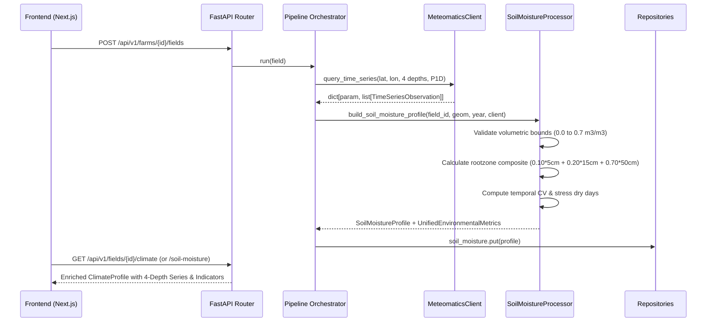
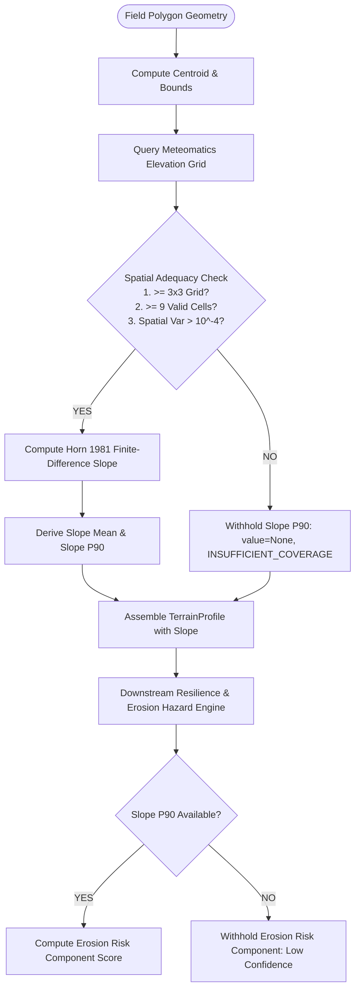

# SOILSTICE — Meteomatics-First Environmental Pipeline Architecture & Integration Guide

## 1. Architectural Overview

SOILSTICE operates an evidence-grounded, multi-provider agronomic intelligence platform designed for regenerative crop rotation planning and ecological resilience assessment. The system architecture enforces strict separation between:
1. **Raw Ingestion & Acquirers (Layer 1):** Low-level HTTP providers with automatic caching, exponential backoff, rate limiting, and credential redaction.
2. **Deterministic Processors (Layer 2):** Spatial reprojection, depth weighting, finite-difference gradient derivations, and cloud-mask accounting.
3. **Analytical Engines (Layer 3):** Calibrated soil health, crop suitability (Liebig minimum rule), and Shannon rotational entropy models.
4. **API & Contract Boundary (Layer 4):** Strongly typed Pydantic v2 schemas mirrored in TypeScript contracts (`openapi-typescript`), strict metric-canonical unit standards, and provenance tracking.
5. **Generative & Interactive Frontend (Layer 5):** React 19 / Next.js 16 UI with TanStack React Query hooks, Tailwind CSS v4, and provenance inspector sidebars.

With this migration, Meteomatics serves as the primary operational provider for continuous environmental metrics (multi-depth soil moisture, elevation, conditional slope, and regional macro-scale vegetation), replacing the fragile legacy workflows that relied on NASA Earthdata HLS discovery, SMAP H5 granule slicing, and SRTM GeoTIFF raster downloads.

```
                      +---------------------------------------+
                      |       SOILSTICE Backend Core          |
                      |   (FastAPI / Python 3.13 / Pydantic)  |
                      +-------------------+-------------------+
                                          |
        +---------------------------------+---------------------------------+
        |                                 |                                 |
+-------v-------+                 +-------v-------+                 +-------v-------+
|  Meteomatics  |                 |  NASA POWER   |                 |  USDA SSURGO  |
|  (Primary P0) |                 |  (Preserved)  |                 |  (Preserved)  |
+-------+-------+                 +-------+-------+                 +-------+-------+
        |                                 |                                 |
        | - Volumetric Soil Water         | - Solar Radiation (ALLSKY)      | - Horizon Sand/Silt/Clay
        |   (-5cm, -15cm, -50cm, -150cm)  | - Daily Tmax, Tmin, Tmean       | - Organic Matter, pH (1:1)
        | - Root-zone Composite           | - Precipitation Totals          | - AWS 0-100cm, AWS 0-150cm
        | - Elevation Grid (Horn Slope)   | - Reference ET0 (Penman-Mont.)  | - Component Soil Taxonomy
        | - Regional NDVI (sat_ndvi:idx)  | - GDD (Cumulative Base 10°C)   | - Hydrologic Groups (A-D)
        +---------------------------------+---------------------------------+
                                          |
                      +-------------------v-------------------+
                      |      Deterministic Aggregators        |
                      |  - Horn Finite-Difference Gradient    |
                      |  - Depth-Weighted Rootzone (10/20/70) |
                      |  - Spatial Adequacy Gating (>=9 pts)  |
                      +-------------------+-------------------+
                                          |
                      +-------------------v-------------------+
                      |      Analytical Engines (P4 - P6)     |
                      |  - Calibrated Resilience (5 Factor)   |
                      |  - Crop Suitability (11 Factor)       |
                      |  - Liebig Minimum Law Enforcement     |
                      +-------------------+-------------------+
                                          |
                      +-------------------v-------------------+
                      |       Next.js 16 Web Dashboard        |
                      |  - 4-Depth Soil Moisture Curves       |
                      |  - Conditional Slope Warnings         |
                      |  - Regional Macro-NDVI Context        |
                      +---------------------------------------+
```

---

## 2. Migration Rationale

Prior to this migration, SOILSTICE suffered chronic degradation and integration fragility stemming from three external download-based pipelines:
1. **NASA HLS (HLSL30 / HLSS30):**
   - *Failure Modes:* NASA CMR STAC search timeouts, Earthdata OAuth bearer token expiration, missing granules over non-CONUS/cloudy periods, complex S3 bucket direct access rules, and massive 30 m GeoTIFF band downloads (>300 MB per scene) causing server memory pressure.
   - *Impact:* Stalled field creation jobs, frequent `UPSTREAM_UNAVAILABLE` errors, and incomplete vegetation phenology.
2. **NASA SMAP L4 (SPL4SMGP):**
   - *Failure Modes:* HDF5 (`.h5`) format complexity, massive daily global grids requiring complex spatial subsetting, Earthdata download redirection quirks, and NSIDC archive latency (3–5 days).
   - *Impact:* Root-zone soil moisture indicators regularly evaluated to `NO_DATA_SOURCE`, forcing fallback to static SSURGO Available Water Storage (AWS).
3. **NASA SRTM GL1 (30 m):**
   - *Failure Modes:* Compressed `.hgt.zip` raster downloads from LP DAAC, coordinate-named tile indexing (`N37W099.hgt`), local unzipping, and GDAL/rasterio IO bottlenecks during field polygon masking.
   - *Impact:* Slow field ingestion (>15s per polygon) and brittle credential dependencies.

**The Solution:**
Transitioning to Meteomatics provides an operational HTTP REST API that delivers assimilated European Centre for Medium-Range Weather Forecasts (ECMWF) IFS model outputs and satellite blend layers with sub-second latencies, unified JSON payloads, and zero file-system raster unpacking overhead.

---

## 3. Provider Responsibility Matrix

| Environmental Metric | Primary Provider | Spatial Support | Temporal Support | Fallback / Secondary |
|---|---|:---:|:---:|---|
| **Surface Soil Moisture (-5 cm)** | Meteomatics (`volumetric_soil_water_-5cm:m3m3`) | Regional Model (~9 km) | Daily (P1D) / Hourly | None |
| **Shallow Soil Moisture (-15 cm)** | Meteomatics (`volumetric_soil_water_-15cm:m3m3`) | Regional Model (~9 km) | Daily (P1D) / Hourly | None |
| **Mid-depth Soil Moisture (-50 cm)** | Meteomatics (`volumetric_soil_water_-50cm:m3m3`) | Regional Model (~9 km) | Daily (P1D) / Hourly | None |
| **Deep Boundary Moisture (-150 cm)** | Meteomatics (`volumetric_soil_water_-150cm:m3m3`) | Regional Model (~9 km) | Daily (P1D) / Hourly | None |
| **Root-zone Composite (0–100 cm)** | Meteomatics (Weighted: 10% 5cm, 20% 15cm, 70% 50cm) | Regional Model (~9 km) | Daily (P1D) Composite | SSURGO AWS (Static) |
| **Elevation (Mean, Min, Max)** | Meteomatics (`elevation:m`) | Field Polygon / Centroid | Static Model | NASA SRTM (Offline / Deprioritized) |
| **Slope & Slope P90** | Meteomatics Grid (Horn Finite-Difference) | Spatial Adequacy Gated (≥9 cells) | Static Model | Withheld (`NOT_COMPUTED`) |
| **Vegetation Index (Regional)** | Meteomatics (`sat_ndvi:idx`) | Regional Support Class R (~9 km) | Daily (P1D) Observations | HLS (Deferred P1) |
| **Canopy Temporal Stability** | Withheld (`NO_DATA_SOURCE`) | Requires 30 m Field Pixels | Multi-Year Phenology | None (Preserved Integrity) |
| **Solar Radiation & Temperature** | NASA POWER Daily AG | Regional Grid (~55 km) | Daily (P1D) Observations | None (Preserved P0) |
| **Precipitation & ET₀** | NASA POWER Daily AG | Regional Grid (~55 km) | Daily (P1D) Observations | PRISM (Planned P1) |
| **Soil Texture, pH, Organic Matter** | USDA NRCS SSURGO (SDA) | Field Polygon Intersect | Component-Weighted Static | None (Preserved P0) |
| **Available Water Storage (AWS)** | USDA NRCS SSURGO (SDA) | Horizon Aggregation (0–150 cm) | Component-Weighted Static | None (Preserved P0) |

---

## 4. Meteomatics Integration Mechanics

### Client Architecture
The `MeteomaticsClient` (`backend/app/providers/meteomatics.py`) wraps HTTP Basic Authentication using `HttpAcquirer` (`backend/app/providers/http.py`), benefiting from:
- Persistent disk caching in `.cache/raw/meteomatics/` keyed by SHA-256 request hash.
- Secret redaction preventing passwords or basic auth tokens from ever appearing in log files or error traces.
- Automatic retry on transient HTTP 429/5xx status codes with exponential backoff.
- Granular error categorization into `MISSING_CREDENTIALS`, `AUTHENTICATION_FAILURE`, `SUBSCRIPTION_LIMITATION`, `PARAMETER_UNAVAILABLE`, `RATE_LIMITED`, `INVALID_REQUEST`, and `NETWORK_FAILURE`.

### Request Syntax & Endpoints
1. **Time-Series Query:**
   ```
   GET https://api.meteomatics.com/{start}--{end}:{step}/{parameters}/{lat},{lon}/json?model={model}
   ```
   *Example:*
   `https://api.meteomatics.com/2025-01-01T00:00:00Z--2025-12-31T00:00:00Z:P1D/volumetric_soil_water_-5cm:m3m3,volumetric_soil_water_-15cm:m3m3,volumetric_soil_water_-50cm:m3m3,volumetric_soil_water_-150cm:m3m3/37.95000,-98.05000/json?model=mix`

2. **Spatial Grid Query:**
   ```
   GET https://api.meteomatics.com/{time}/{parameters}/{lat_max},{lon_min}_{lat_min},{lon_max}:{res_lat},{res_lon}/json?model={model}
   ```
   *Rectangle Bounding Box:* Formatted as upper-left (`lat_max, lon_min`) to lower-right (`lat_min, lon_max`), followed by resolution step in degrees (e.g., `0.005,0.005`).

---

## 5. Soil Moisture Pipeline Methodology

### Parameterization
SOILSTICE captures four distinct physical layers from ECMWF-assimilated numerical weather models:
1. `volumetric_soil_water_-5cm:m3m3`: Topsoil surface skin moisture (evaporation interface).
2. `volumetric_soil_water_-15cm:m3m3`: Shallow seedling and germination zone.
3. `volumetric_soil_water_-50cm:m3m3`: Active root-zone absorption core.
4. `volumetric_soil_water_-150cm:m3m3`: Sub-root deep drainage and water table recharge boundary.

### Defensible Depth Weighting
Crop root density is non-linear and decreases exponentially with depth. To synthesize a continuous active root-zone composite (0–100 cm) without introducing unscientific artifacts, SOILSTICE computes:

$$\theta_{\text{rootzone}} = 0.10 \cdot \theta_{-5\text{cm}} + 0.20 \cdot \theta_{-15\text{cm}} + 0.70 \cdot \theta_{-50\text{cm}}$$

The deep boundary layer ($\theta_{-150\text{cm}}$) is explicitly excluded from the active vegetative root-zone composite to avoid artificially inflating moisture estimates in drought-stressed topsoil when a deep water table is present.

### Dynamics & Risk Indicators
From the daily root-zone time series, the pipeline derives:
- **Seasonal Mean:** Average volumetric water content over the specified growing season window.
- **Temporal Coefficient of Variation (CV):** $\text{CV} = \frac{\sigma}{\mu}$, measuring hydrological volatility.
- **Dry Days Count:** Number of days where root-zone moisture drops below critical crop stress thresholds ($< 0.15\text{ m}^3/\text{m}^3$).

---

## 6. Terrain and Conditional Slope Methodology

### Spatial Adequacy Gating
Computing numerical derivatives (slope) across coarse spatial grids risks generating false topography when resolution is insufficient to capture field boundaries. To prevent synthetic slopes, SOILSTICE enforces a strict three-part **Spatial Adequacy Gate** (`backend/app/processing/terrain.py`):
1. **Grid Dimensionality:** The query window must span at least a $3 \times 3$ matrix ($\text{rows} \ge 3$, $\text{cols} \ge 3$).
2. **Cell Count:** At least 9 valid elevation samples within the field polygon.
3. **Variance Threshold:** Spatial variance of elevation must strictly exceed $10^{-4}\text{ m}^2$. Flat block interpolations with zero variance immediately fail the adequacy check.

### Horn Finite-Difference Derivation
When spatial adequacy is satisfied, slope is computed using Horn’s (1981) $3 \times 3$ finite-difference weighted gradient algorithm on projected metric spacing ($\Delta x, \Delta y$ in meters):

$$\frac{\partial z}{\partial x} = \frac{(c + 2f + i) - (a + 2d + g)}{8 \Delta x}, \quad \frac{\partial z}{\partial y} = \frac{(g + 2h + i) - (a + 2b + c)}{8 \Delta y}$$

$$\text{Slope (\%)} = 100 \times \sqrt{\left(\frac{\partial z}{\partial x}\right)^2 + \left(\frac{\partial z}{\partial y}\right)^2}$$

### Conditional Withholding
If the spatial adequacy check fails:
- `elevation_mean`, `elevation_min`, and `elevation_max` are safely computed from available centroid/polygon samples.
- `slope_mean_pct` and `slope_p90_pct` are **withheld** (`value: None`, `missing_reason: "INSUFFICIENT_COVERAGE"`).
- Downstream **Erosion Hazard Scoring** is withheld with a clear explanatory notice rather than emitting a fabricated score.

---

## 7. Regional Vegetation Methodology

### Regional Satellite NDVI (`sat_ndvi:idx`)
Meteomatics provides an operational satellite NDVI blend product (`sat_ndvi:idx`) at approximately 9 km spatial resolution.
- It is assigned **Support Class R** (Regional Context).
- It provides macro-scale vegetative greenness trends and seasonal peak timing.

### Scientific Safeguards (HLS Independence)
- Regional NDVI **must never** be represented as equivalent to field-level 30 m HLS imagery.
- The **Canopy Temporal Stability Model** (`ndvi_peak_cv`) is intentionally withheld (`NOT_COMPUTED`). Coarse 9 km pixels mix multiple farm fields, pastures, and roads, making intra-field pixel CV scientifically invalid.
- Phenological transition markers requiring fine spatial half-amplitude crossings (`greenup_date`, `senescence_date`) are withheld.

---

## 8. Preserved Integrations

1. **NASA POWER Daily AG (`nasa_power_daily_ag`):**
   - Preserved as primary provider for solar radiation (`ALLSKY_SFC_SW_DWN`), temperatures (`T2M_MAX`, `T2M_MIN`, `T2M`), cumulative heat units (GDD Base 10°C / Cap 30°C), reference evapotranspiration ($\text{ET}_0$), and climatic water balance ($\text{P} - \text{ET}_0$).
2. **USDA NRCS SSURGO (`usda_nrcs_ssurgo_sda`):**
   - Preserved as authoritative provider for soil horizon physical properties: sand/silt/clay fractions, 1:1 soil pH, organic matter percentage, available water capacity (AWC), Available Water Storage (AWS 0–100 cm, 0–150 cm), component drainage classes, and hydrologic groups.
3. **USDA NASS CDL (`usda_nass_cdl`):**
   - Preserved for 5-year historical crop sequence reconstruction and Shannon rotational diversity index.
4. **Phase 6 Crop Suitability Engine (`app/suitability/`):**
   - 100% preserved. All 11 environmental factor evaluators, factor weights, and Liebig’s Law of the Minimum constraints remain unaltered.

---

## 9. Deprioritized Integrations

The following legacy workflows have been deprioritized and removed from the active execution path:
- **NASA HLS Imagery Downloads:** Removed from mandatory field processing steps.
- **NASA Earthdata OAuth/Bearer Token Authentication:** Not required for baseline field creation or analysis.
- **SMAP HDF5 Ingestion:** Retired in favor of continuous Meteomatics soil moisture.
- **SRTM 1-Arcsecond GeoTIFF Downloads:** Replaced by on-demand Meteomatics elevation queries.

---

## 10. Metric and Indicator Definitions

| Indicator Key | Canonical Unit | Category | Scientific Description |
|---|:---:|:---:|---|
| `sm_surface_mean_season` | $\text{m}^3/\text{m}^3$ | `soil_moisture` | Seasonal mean topsoil volumetric water (-5 cm). |
| `sm_shallow_mean_season` | $\text{m}^3/\text{m}^3$ | `soil_moisture` | Seasonal mean shallow volumetric water (-15 cm). |
| `sm_middepth_mean_season` | $\text{m}^3/\text{m}^3$ | `soil_moisture` | Seasonal mean mid-depth volumetric water (-50 cm). |
| `sm_deep_mean_season` | $\text{m}^3/\text{m}^3$ | `soil_moisture` | Seasonal mean sub-root drainage boundary water (-150 cm). |
| `sm_rootzone_mean_season` | $\text{m}^3/\text{m}^3$ | `soil_moisture` | Core root-zone layer mean water content. |
| `sm_rootzone_dry_days` | $\text{days}$ | `soil_moisture` | Number of days root-zone moisture was below stress threshold. |
| `elevation_mean` | $\text{m}$ | `terrain` | Zonal mean elevation above sea level. |
| `slope_mean_pct` | $\%$ | `terrain` | Mean surface gradient across adequate grid cells. |
| `slope_p90_pct` | $\%$ | `terrain` | 90th percentile slope gradient (erosion hazard input). |
| `regional_ndvi_peak` | $\text{unitless}$ | `vegetation` | Maximum regional satellite NDVI over the season window. |
| `regional_ndvi_mean` | $\text{unitless}$ | `vegetation` | Seasonal mean regional satellite NDVI. |

---

## 11. Data Flow Diagrams

### Soil Moisture & Hydrology Pipeline


### Terrain & Conditional Slope Pipeline


---

## 12. Credential Setup and Diagnostics

### Credential Configuration
1. Open `backend/.env` (created from `backend/.env.example`).
2. Add your assigned Meteomatics API credentials:
   ```bash
   METEOMATICS_USERNAME=your_username_here
   METEOMATICS_PASSWORD=your_password_here
   ```
   *Note: Credentials are never stored in git or exposed to the client bundle.*

### Diagnostic Verification Command
Run the diagnostic suite via npm:
```bash
npm run diagnostics:environment
```
The command automatically checks:
1. Environment variable presence and format.
2. HTTP Basic Authentication against `api.meteomatics.com`.
3. Minimal valid provider request (`elevation:m`).
4. 4-depth soil moisture parameter availability.
5. Elevation and conditional slope spatial adequacy.
6. Regional NDVI retrieval.
7. NASA POWER integration health.
8. USDA NRCS SSURGO integration health.
9. Contract and schema validation across all metrics.

**Output Artifacts:**
- `reports/environmental-pipeline-health.json`
- `reports/environmental-pipeline-health.md`

---

## 13. API Contract Changes

1. **New Vocabulary Entries (`backend/app/contracts/vocab.py` & `src/types/contracts.ts`):**
   - Added `"meteomatics"` to `DatasetId`.
   - Added `"PT1H"` to `TemporalResolution`.
   - Added `"m3/m3"` to `Unit`.
   - Added indicator keys: `sm_surface_mean_season`, `sm_shallow_mean_season`, `sm_middepth_mean_season`, `sm_deep_mean_season`, `regional_ndvi_mean`, `regional_ndvi_peak`.
2. **Unified Environmental Metric Schema:**
   - Standardized contract entity `UnifiedEnvironmentalMetric` capturing provider provenance, spatial resolution, temporal support, coverage fractions, and confidence classifications.
3. **Dedicated Soil Moisture Endpoint:**
   - `GET /api/v1/fields/{field_id}/soil-moisture` returning `SoilMoistureProfile`.

---

## 14. Frontend Visualization Changes

- **Soil Moisture Tab (`src/components/views/environment-view.tsx`):**
  - Displays four depth metric stat cards: Surface (-5 cm), Shallow (-15 cm), Mid-depth (-50 cm), and Deep (-150 cm).
  - Displays the Depth-Weighted Root-zone Composite card ($0.10 \cdot 5\text{cm} + 0.20 \cdot 15\text{cm} + 0.70 \cdot 50\text{cm}$).
  - Renders a multi-depth daily continuous time-series chart showing depth curves with distinct visual hierarchy.
- **Terrain Tab:**
  - Identifies Meteomatics elevation model provenance.
  - Displays conditional slope warning alert whenever slope derivation is withheld due to spatial grid adequacy.
- **Vegetation Tab:**
  - Shows an informational banner explicitly clarifying that Meteomatics `sat_ndvi:idx` is a regional macro-scale indicator (Support Class R) and that 30 m HLS field-level canopy stability is withheld.

---

## 15. Resilience and Suitability Engine Interactions

- **Resilience Engine (`app/analytics/resilience.py`):**
  - Climate Exposure component uses regional soil moisture dry days and precipitation anomalies.
  - Terrain Erosion Risk component requires slope P90; if withheld, component is safely marked unavailable rather than fabricated.
  - Vegetation Stability component requires field-scale 30 m HLS canopy stability; regional NDVI is **not substituted**, maintaining the strict 4-of-5 component quorum rule.
- **Crop Suitability Engine (`app/suitability/`):**
  - All 11 factor evaluators function identically.
  - Available water capacity (AWC) and AWS 0–150 cm remain grounded in SSURGO soil taxonomy.
  - Topographic slope factors evaluate slope percent against crop tolerance tables.
  - Liebig’s Law of the Minimum remains fully enforced.

---

## 16. Known Limitations and Technical Debt

1. **Coarse Regional Resolution (~9 km):**
   - Modeled soil moisture represents regional grid cells (~8,100 ha). Micro-topographical drainage features (furrows, low spots) are not captured.
2. **Centroid Extraction on Small Fields:**
   - Fields smaller than ~5 ha query a single point centroid, making internal spatial variance zero and correctly withholding slope derivation.
3. **Subscription Parameter Limitations:**
   - Certain specialized weather parameters may require specific commercial tiers. The diagnostic CLI detects and reports tier limitations.

---

## 17. Production Deployment Considerations

1. **Rate Limits & Concurrency:**
   - Meteomatics imposes request-per-second constraints depending on package tier.
   - `HttpAcquirer` caching prevents repeated external requests for previously fetched seasonal dates.
2. **Environment Variable Injection:**
   - In production (Docker / Kubernetes / Cloud Run), set `METEOMATICS_USERNAME` and `METEOMATICS_PASSWORD` in the container environment or secret manager.
3. **Cache Storage Volume:**
   - Ensure the raw cache directory (`.cache/raw/`) is mounted on persistent storage to maximize cache hits across restarts.

---

## 18. Maintenance and Troubleshooting Guide

| Symptom | Probable Cause | Action |
|---|---|---|
| `AUTHENTICATION_FAILURE (401)` | Invalid username/password | Verify `METEOMATICS_USERNAME` and `METEOMATICS_PASSWORD` in `backend/.env`. |
| `SUBSCRIPTION_LIMITATION (402/403)` | Parameter or model tier restricted | Verify subscription supports requested parameters (`volumetric_soil_water`, `elevation`, `sat_ndvi`). |
| `PARAMETER_UNAVAILABLE (404)` | Date range outside model archive | Check temporal bounds; use `mix` model for operational dates. |
| Slope P90 shows "Withheld" | Spatial adequacy gate failed (< 9 cells or flat) | Expected behavior for small/flat fields. Topography is preserved; false slope calculation is prevented. |
| Vegetation stability shows "Unavailable" | Scientific safeguard active | Expected behavior. Regional NDVI is not coerced into the 30 m HLS Canopy Temporal Stability Model. |
| Diagnostics command fails | Virtualenv not detected | Run `npm run diagnostics:environment` from repository root where `backend/.venv` is located. |
