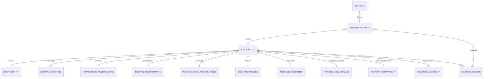

# SOILSTICE Backend Crop Knowledge Base — Data Dictionary
**Document Version:** `1.1.0-RECONCILED`  
**Status:** Approved Reconciled Architectural Baseline  
**Governing Schema:** `data/processed/crop_knowledge_base/schema.json` (Draft-07 Compliant)  
**Target Platform:** SOILSTICE Backend Recommendation Engine & Decision-Support Web API  

---

## 1. Architectural Model & Reconciled Design Principles

The SOILSTICE Crop Knowledge Base is an independent, normalized backend data model governing the 14 canonical U.S. agricultural crops (`CRP001` through `CRP014`). It acts as the single source of truth across agronomic, physiological, edaphic, and rotational domains for the SOILSTICE platform.

### Reconciled Design Rules (Stage 0 Baseline)
1. **Canonical Crop Scope:** Exactly 14 crops (`CRP001`–`CRP014`) as established by the project registry (`data/processed/crop_registry.json`).
2. **Explicit Null Values:** Unknown or unresearched values are strictly represented as `null`. No dummy values (e.g. `0`, `-999`, `"N/A"`, or arbitrary estimates) are permitted.
3. **Mandatory Physical Units:** Every quantitative attribute carries a defined, non-null physical unit string (e.g. `celsius`, `days`, `mm`, `kg_per_ha`), even when the numerical value is currently `null`.
4. **Attribute-Level Provenance & Limitations:** Every quantitative, qualitative, and boolean parameter encapsulates its own measurement type, confidence rating, evidence cross-reference array (`evidence_ids`), and scientific limitations.
5. **Separation of Source Quality and Confidence:** Source quality (`source_quality` in Evidence Records) reflects the authority of the publication (peer-reviewed journal, extension bulletin, regulatory master label), whereas attribute `confidence` reflects certainty in the specific parameter value.
6. **JSON as Source of Truth:** `crop_knowledge_base.json` is the canonical master. All CSV files (`crop_attributes.csv`, `crop_rotation_compatibility.csv`, `crop_evidence.csv`) are strictly generated projections.

---

## 2. Reconciled Value Object Specifications

All agronomic domains utilize standardized value object patterns ensuring uniform parsing and strict typing across backend microservices.

### 2.1 QuantitativeAttribute
Represents numeric parameters (discrete, continuous, or ranges) with mandatory physical units and methodological metadata.

| Field Name | JSON Type | Description | Allowed Values / Formats | Nullable |
|---|---|---|---|---|
| `value` | `number` \| `null` | Point estimate or baseline measured value | Floating-point or integer | Yes |
| `min_value` | `number` \| `null` | Lower bound of reported range | Floating-point or integer | Yes |
| `max_value` | `number` \| `null` | Upper bound of reported range | Floating-point or integer | Yes |
| `unit` | `string` | **Mandatory physical unit string** | See Section 5: Standard Physical Units | **No (Always defined)** |
| `measurement_type` | `string` \| `null` | Empirical basis of parameter | `"measured"`, `"reported_range"`, `"estimate"`, `"derived"` | Yes |
| `growth_stage` | `string` \| `null` | Specific phenological growth stage | e.g. `"VT/R1"`, `"V4-V6"`, `"anthesis"`, `"seedling"` | Yes |
| `region_scope` | `string` \| `null` | Geographic boundary of measurement | e.g. `"National"`, `"US_CORN_BELT"`, `"Northern Plains"` | Yes |
| `confidence` | `string` \| `null` | Scientific evidence confidence tier | `"high"`, `"medium"`, `"low"` | Yes |
| `evidence_ids` | `array` | Cross-reference IDs to Evidence Registry | Array of strings matching `^EV[0-9]{4}$` | No (empty `[]` if none) |
| `limitations` | `string` \| `null` | Methodological caveats, soil assumptions, or bounds | Free text string | Yes |

### 2.2 QualitativeAttribute
Represents descriptive evaluations, ratings, or categorical agronomic assessments.

| Field Name | JSON Type | Description | Allowed Values / Formats | Nullable |
|---|---|---|---|---|
| `rating` | `string` \| `null` | Standardized qualitative rating or tier | Standard ordinal rating scale (e.g. `"very_sensitive"`, `"moderate"`) | Yes |
| `description` | `string` \| `null` | Authoritative explanatory text or context | Scientific description | Yes |
| `measurement_type` | `string` \| `null` | Source classification | `"qualitative"`, `"expert_consensus"`, `"field_observation"` | Yes |
| `growth_stage` | `string` \| `null` | Phenological stage of sensitivity | Growth stage descriptor | Yes |
| `region_scope` | `string` \| `null` | Geographic applicability | Region identifier | Yes |
| `confidence` | `string` \| `null` | Scientific evidence confidence tier | `"high"`, `"medium"`, `"low"` | Yes |
| `evidence_ids` | `array` | Cross-reference IDs to Evidence Registry | Array of strings matching `^EV[0-9]{4}$` | No (empty `[]` if none) |
| `limitations` | `string` \| `null` | Scope boundaries, soil/temperature caveats | Free text string | Yes |

### 2.3 BooleanAttribute
Represents binary physiological or agronomic traits with support for genotype variation and unknown field states.

| Field Name | JSON Type | Description | Allowed Values / Formats | Nullable |
|---|---|---|---|---|
| `value` | `boolean` \| `null` | Trait value | `true`, `false`, `null` | Yes |
| `notes` | `string` \| `null` | Botanical or agronomic context | Text string | Yes |
| `genotype_variation_notes` | `string` \| `null` | Cultivar, maturity group, or race variation | Explains genotype differences (e.g. facultative vs obligate vernalization) | Yes |
| `measurement_type` | `string` \| `null` | Empirical basis | `"measured"`, `"reported_range"`, `"estimate"`, `"qualitative"`, `"derived"` | Yes |
| `confidence` | `string` \| `null` | Confidence tier | `"high"`, `"medium"`, `"low"` | Yes |
| `evidence_ids` | `array` | Evidence IDs | Array of strings matching `^EV[0-9]{4}$` | No (empty `[]` if none) |
| `limitations` | `string` \| `null` | Scope restrictions | Free text string | Yes |

---

## 3. Top-Level Entity Definitions & Required Data Domains

### Domain 1: Crop Identity & Multi-Role Production (`crop_identity`)
*Governs taxonomy, canonical portfolio classification, and multi-functional agricultural production roles.*

| JSON Field | Type | CSV Mapping | Description & Agronomic Rules |
|---|---|---|---|
| `common_name` | `string` | `common_name` | Canonical common name (e.g. `"Corn (Maize)"`, `"Winter Wheat"`). |
| `scientific_name` | `string` | `scientific_name` | Botanical binomial with taxonomic authority (*Zea mays* L.). |
| `taxonomic_authority` | `string` \| `null` | `taxonomic_authority` | Taxonomic author citation (`"L."`, `"(L.) Merr."`, `"Roth"`). |
| `botanical_family` | `string` | `botanical_family` | Botanical family (`"Poaceae"`, `"Fabaceae"`, `"Brassicaceae"`, `"Malvaceae"`). |
| `crop_group` | `string` | `crop_group` | Functional commodity group (`"Cereal"`, `"Legume"`, `"Fiber crop"`, etc.). |
| `portfolio_role` | `string` (enum) | `portfolio_role` | Canonical SOILSTICE project portfolio category: `"primary_commercial"` or `"rotation_cover"`. |
| `lifecycle_class` | `string` (enum) | `lifecycle_class` | `"Annual"`, `"Biennial"`, `"Perennial"`. |
| `functional_roles` | `string[]` | — | Multi-functional agronomic roles from registry. |
| `production_roles` | `string[]` | `production_roles` | Concrete on-farm production roles (e.g. `commercial_cash_grain`, `cover_crop`, `forage_hay`, `green_manure`, `companion_nurse_crop`). |
| `can_serve_as_cover_crop` | `boolean` | `can_serve_as_cover_crop` | Explicit flag: `true` if the crop can function as a soil-protective cover crop. |
| `commercial_harvest_feasible` | `boolean` | `commercial_harvest_feasible` | Explicit flag: `true` if commercial harvest (grain, fiber, forage hay) is feasible and standard. |
| `primary_harvest_products` | `string[]` | `primary_harvest_products` | Primary harvest outputs (e.g. `["grain", "forage_hay", "straw"]`). |
| `is_cover_crop` | `boolean` | `is_cover_crop` | Legacy portfolio flag (corresponds to `portfolio_role == "rotation_cover"`). |
| `commercial_harvest_intended` | `boolean` | `commercial_harvest_intended` | Legacy commercial intention flag. |
| `usda_plants_symbol` | `string` \| `null` | `usda_plants_symbol` | Official USDA PLANTS symbol (`ZEMA`, `GLMA4`, `TRAE`, etc.). |

> [!NOTE]
> **Multi-Role Crop Rule:** Rotation/cover crops are not exclusively cover crops. For example, **Oats (`CRP010`)** serves as a cash food grain, high-quality forage hay/greenchop, companion nurse crop, and cover crop. **Alfalfa (`CRP011`)** is a premier commercial perennial forage crop and soil conditioner. Both have `commercial_harvest_feasible: true` and `can_serve_as_cover_crop: true`.

### Domain 2: Growing Duration & Phenology (`growing_duration`)
*Disaggregates active vegetative/reproductive development days from calendar occupancy.*

| JSON Field | Object Type | Expected Unit | CSV Column Mapping | Description |
|---|---|---|---|---|
| `active_growth_duration_days` | `QuantitativeAttribute` | `days` | `active_growth_duration_min_days`, `active_growth_duration_max_days` | Active physiological cell division days (excludes overwinter dormancy). |
| `calendar_occupancy_duration_days` | `QuantitativeAttribute` | `days` | `calendar_occupancy_min_days`, `calendar_occupancy_max_days` | Total field occupancy from seeding to harvest (e.g. 220–285 d for winter cereals). |
| `growing_degree_days_base_temp_c` | `QuantitativeAttribute` | `celsius` | `gdd_base_temp_c` | Base temperature floor for heat unit accumulation ($T_{\text{base}}$). |
| `growing_degree_days_accumulated` | `QuantitativeAttribute` | `gdd_c` | `gdd_accumulated_min`, `gdd_accumulated_max` | Cumulative GDD required to reach physiological maturity. |
| `vernalization_required` | `BooleanAttribute` | — | `vernalization_required` | Obligate cold requirement; accounts for winter vs spring genotype variation. |
| `vernalization_duration_days` | `QuantitativeAttribute` | `days` | — | Effective chilling period (typically 35–60 days at 0°–7°C). |
| `photoperiod_sensitivity` | `QualitativeAttribute` | — | — | Daylength sensitivity classification. |
| `growth_stages` | `GrowthStageDefinition[]` | — | — | Structured array of stage-specific BBCH codes and GDD requirements. |

### Domain 3: Temperature Requirements & Thermal Stress (`temperature_requirements`)
*Governs cardinal temperatures and empirical yield breakpoints.*

| JSON Field | Object Type | Expected Unit | CSV Column Mapping | Description |
|---|---|---|---|---|
| `base_temperature_c` | `QuantitativeAttribute` | `celsius` | `base_temperature_c` | Minimum physiological zero temperature. |
| `optimal_temperature_min_c` | `QuantitativeAttribute` | `celsius` | `optimal_temperature_min_c` | Lower bound of daytime optimal range. |
| `optimal_temperature_max_c` | `QuantitativeAttribute` | `celsius` | `optimal_temperature_max_c` | Upper bound of daytime optimal range. |
| `absolute_min_survival_c` | `QuantitativeAttribute` | `celsius` | `absolute_min_survival_c` | Minimum survival temperature during vegetative growth. |
| `absolute_max_survival_c` | `QuantitativeAttribute` | `celsius` | `absolute_max_survival_c` | Maximum survival temperature before irreversible cellular death. |
| `frost_tolerance` | `QualitativeAttribute` | — | `frost_tolerance_rating` | Standard ordinal frost rating. |
| `heat_stress_threshold_c` | `QuantitativeAttribute` | `celsius` | `heat_stress_threshold_c` | Empirical statistical yield decline breakpoint (e.g. 29.0°C in corn; 34.0°C in winter wheat). |
| `critical_thermal_thresholds` | `CriticalThermalThreshold[]` | — | — | Stage-specific heat stress thresholds (anthesis, grain fill). |

### Domain 4: Rainfall Requirements & Moisture Context (`rainfall_requirements`)
*Disaggregates seasonal atmospheric precipitation, effective precipitation, and soil moisture.*

| JSON Field | Object Type | Expected Unit | CSV Column Mapping | Description & Hydrological Distinction |
|---|---|---|---|---|
| `seasonal_precipitation_min_mm` | `QuantitativeAttribute` | `mm` | `seasonal_precipitation_min_mm` | Minimum gross atmospheric precipitation across the growing cycle. |
| `seasonal_precipitation_max_mm` | `QuantitativeAttribute` | `mm` | `seasonal_precipitation_max_mm` | Maximum gross seasonal rainfall before disease or management penalties escalate. |
| `seasonal_effective_precipitation_min_mm` | `QuantitativeAttribute` | `mm` | `seasonal_effective_precipitation_min_mm` | Minimum effective rainfall that infiltrates the root zone without runoff/percolation. |
| `seasonal_effective_precipitation_max_mm` | `QuantitativeAttribute` | `mm` | `seasonal_effective_precipitation_max_mm` | Maximum effective rainfall usable by crop. **Not a waterlogging threshold.** |
| `seasonal_effective_precipitation_optimal_min_mm` | `QuantitativeAttribute` | `mm` | `seasonal_effective_precipitation_optimal_min_mm` | Lower bound of optimal effective rainfall. |
| `seasonal_effective_precipitation_optimal_max_mm` | `QuantitativeAttribute` | `mm` | `seasonal_effective_precipitation_optimal_max_mm` | Upper bound of optimal effective rainfall. |
| `soil_water_availability_context` | `QualitativeAttribute` | — | — | Contextual guidance on root zone available water capacity (AWC). |
| `irrigation_requirement_context` | `QualitativeAttribute` | — | — | Supplemental irrigation rules when effective precipitation falls short of $ET_c$. |

### Domain 5: Water Demand & Environmental Tolerances (`water_demand_and_tolerance`)
*Governs consumptive water use ($ET_c$) and stage-dependent waterlogging dynamics.*

| JSON Field | Object Type | Expected Unit | CSV Column Mapping | Description |
|---|---|---|---|---|
| `seasonal_consumptive_water_use_etc_mm` | `QuantitativeAttribute` | `mm` | `seasonal_consumptive_water_use_etc_min_mm`, `seasonal_consumptive_water_use_etc_max_mm` | Total crop evapotranspiration under standard conditions ($ET_c$). |
| `peak_daily_water_use_mm_day` | `QuantitativeAttribute` | `mm_per_day` | `peak_daily_water_use_mm_day` | Maximum daily moisture extraction at peak canopy/reproductive stage. |
| `net_irrigation_requirement_mm` | `QuantitativeAttribute` | `mm` | `net_irrigation_requirement_mm` | Net moisture deficit ($IR_{net} = ET_c - P_{eff} - \Delta S$). |
| `water_use_efficiency_kg_per_m3` | `QuantitativeAttribute` | `kg_per_m3` | — | Dry matter or grain produced per cubic meter of water consumed. |
| `drought_tolerance` | `QualitativeAttribute` | — | `drought_tolerance_rating` | Resiliency to extended soil moisture deficits. |
| `heat_tolerance` | `QualitativeAttribute` | — | `heat_tolerance_rating` | Resilience to high vapor pressure deficit (VPD) and thermal stress. |
| `waterlogging_tolerance` | `QualitativeAttribute` | — | `waterlogging_tolerance_rating` | **Independent of seasonal rainfall.** Evaluates stage-dependent anoxia (subterranean vs aerial growing points) and temperature interactions. |

### Domain 6: Soil Preferences & Edaphic Dynamics (`soil_preferences`)
*Governs pH boundaries, salinity response (Maas-Hoffman), texture, and drainage classes.*

| JSON Field | Object Type | Expected Unit | CSV Column Mapping | Description |
|---|---|---|---|---|
| `soil_ph_optimal_min` / `max` | `QuantitativeAttribute` | `ph_scale` | `soil_ph_optimal_min`, `soil_ph_optimal_max` | Optimal soil pH range. |
| `soil_ph_tolerated_min` / `max` | `QuantitativeAttribute` | `ph_scale` | `soil_ph_tolerated_min`, `soil_ph_tolerated_max` | Minimum/maximum tolerated pH before toxicities or micronutrient lockout occur. |
| `salinity_tolerance_ec_e_threshold_ds_m` | `QuantitativeAttribute` | `ds_per_m` | `salinity_tolerance_ec_e_threshold_ds_m` | Saturated extract electrical conductivity threshold ($EC_e$, dS/m). |
| `salinity_yield_decline_slope_percent` | `QuantitativeAttribute` | `percent_per_ds_m` | `salinity_yield_decline_slope_percent` | Percent yield reduction per dS/m increase above threshold. |
| `salinity_tolerance_category` | `QualitativeAttribute` | — | `salinity_tolerance_category` | Standard Maas-Hoffman category. |
| `soil_texture_preferences` | `SoilTexturePreference[]` | — | — | Suitability ratings across the 12 USDA textural classes. |
| `soil_drainage_class_preferences` | `SoilDrainageClassPreference[]` | — | — | Suitability ratings across the 7 NRCS drainage classes. |

### Domain 7: Root System Architecture & Nutrient Removal (`root_and_nutrients`)
*CRITICAL AGRONOMIC RULE: Disaggregates effective water extraction depth from maximum anatomical root penetration.*

| JSON Field | Object Type | Expected Unit | CSV Column Mapping | Description & Distinction |
|---|---|---|---|---|
| `effective_water_extraction_depth_cm` | `QuantitativeAttribute` | `cm` | `effective_water_extraction_depth_min_cm`, `max_cm` | **Active moisture zone**: Soil depth containing $\ge 80\%$ of active functional root extraction. |
| `maximum_anatomical_root_depth_cm` | `QuantitativeAttribute` | `cm` | `maximum_anatomical_root_depth_min_cm`, `max_cm` | **Maximum anatomical penetration**: Deepest recorded vertical penetration in unconstrained loess/alluvium. |
| `root_system_architecture` | `QualitativeAttribute` | — | `root_system_architecture` | Morphological class (taproot, fibrous, branched). |
| `compaction_alleviation_potential` | `QualitativeAttribute` | — | `compaction_alleviation_potential` | Bio-drilling capability through compacted plow layers. |
| `nitrogen_uptake_per_unit_yield` | `QuantitativeAttribute` | `kg_n_per_metric_ton` | `nitrogen_uptake_per_unit_yield_val`, `unit` | Total crop N uptake per unit grain produced. |
| `phosphorus_removal_per_unit_yield` | `QuantitativeAttribute` | `kg_p2o5_per_metric_ton` | `phosphorus_removal_per_unit_yield_val`, `unit` | Grain nutrient removal in $P_2O_5$ equivalent per unit yield. |
| `potassium_removal_per_unit_yield` | `QuantitativeAttribute` | `kg_k2o_per_metric_ton` | `potassium_removal_per_unit_yield_val`, `unit` | Grain nutrient removal in $K_2O$ equivalent per unit yield. |
| `total_seasonal_n_uptake_kg_ha` | `QuantitativeAttribute` | `kg_per_ha` | `total_seasonal_n_uptake_kg_ha_min`, `max` | Total seasonal biomass nitrogen uptake. |
| `total_seasonal_p2o5_uptake_kg_ha` | `QuantitativeAttribute` | `kg_per_ha` | `total_seasonal_p2o5_uptake_kg_ha_min`, `max` | Total seasonal biomass phosphorus uptake. |
| `total_seasonal_k2o_uptake_kg_ha` | `QuantitativeAttribute` | `kg_per_ha` | `total_seasonal_k2o_uptake_kg_ha_min`, `max` | Total seasonal biomass potassium uptake. |

### Domain 8: Nitrogen, Residue, & Biomass Dynamics (`nitrogen_and_biomass`)
*CRITICAL AGRONOMIC RULE: Disaggregates gross biological $N_2$ fixation, residue N content, harvest export, net soil balance, and rotational fertilizer credit.*

| JSON Sub-block / Field | Object Type | Expected Unit | CSV Column Mapping | Description & Methodological Rule |
|---|---|---|---|---|
| **`biological_nitrogen_fixation`** | | | | |
| `has_symbiotic_fixation_capacity` | `BooleanAttribute` | — | `has_symbiotic_fixation_capacity` | Botanical capability for symbiotic fixation (Fabaceae). Does not guarantee active field fixation without proper inoculation. |
| `rhizobium_symbiont_species` | `QualitativeAttribute` | — | — | Compatible bacterial inoculant symbiont. |
| `percent_n_derived_from_atmosphere_ndfa` | `QuantitativeAttribute` | `percent` | `percent_ndfa_min`, `max` | $\%Ndfa$: Proportion of plant N acquired via fixation. |
| `total_gross_n_fixed_kg_ha` | `QuantitativeAttribute` | `kg_n_per_ha` | `total_gross_n_fixed_kg_ha_min`, `max` | Gross atmospheric $N_2$ fixed per hectare per season. |
| `effective_fixation_conditions` | `QualitativeAttribute` | — | — | Field conditions governing active nodulation. |
| **`residue_and_harvest_nitrogen_dynamics`** | | | | |
| `residue_nitrogen_concentration_percent` | `QuantitativeAttribute` | `percent` | `residue_nitrogen_concentration_percent` | Percentage of nitrogen in dry crop residue biomass. |
| `residue_nitrogen_content_kg_ha` | `QuantitativeAttribute` | `kg_n_per_ha` | `residue_nitrogen_content_kg_ha` | Total elemental nitrogen returned to soil in crop residue. |
| `harvested_biomass_nitrogen_export_kg_ha` | `QuantitativeAttribute` | `kg_n_per_ha` | `harvested_biomass_nitrogen_export_kg_ha` | Elemental nitrogen exported in harvested grain, fiber, or forage. |
| `net_soil_nitrogen_balance_kg_ha` | `QuantitativeAttribute` | `kg_n_per_ha` | `net_soil_nitrogen_balance_kg_ha` | Partial agronomic N flux ($	ext{Gross Fixed N} - 	ext{Harvested N Export}$). In grain legumes, frequently neutral or negative. For unharvested green manure crops (e.g. hairy vetch), populated as null because gross biological fixation cannot be equated to net humified soil organic N accumulation due to dynamic environmental losses (volatilization, denitrification, leaching) upon rapid mineralization. |
| `nitrogen_balance_assessment` | `QualitativeAttribute` | — | — | Contextual summary of net nitrogen balance. |
| **`successor_nitrogen_credit`** | | | | |
| `fertilizer_equivalent_n_credit_lb_ac` | `QuantitativeAttribute` | `lb_n_per_acre` | `successor_n_credit_fertilizer_equiv_lb_ac_min`, `max` | Rotational fertilizer-N replacement credit. **Do not infer directly from gross N fixation.** |
| `fertilizer_equivalent_n_credit_kg_ha` | `QuantitativeAttribute` | `kg_n_per_ha` | `successor_n_credit_fertilizer_equiv_kg_ha_min`, `max` | Fertilizer-N credit in metric units. |
| `credit_mechanism` | `QualitativeAttribute` | — | `successor_n_credit_mechanism` | Mechanism (e.g. reduced microbial immobilization vs rapid mineralization of low C:N green manure). |
| **`biomass_and_soil_cover`** | | | | |
| `aboveground_dry_matter_biomass_kg_ha` | `QuantitativeAttribute` | `kg_per_ha` | `biomass_aboveground_dry_matter_kg_ha_min`, `max` | Total dry matter residue generated (kg/ha). |
| `root_dry_matter_biomass_kg_ha` | `QuantitativeAttribute` | `kg_per_ha` | — | Belowground root dry matter contribution. |
| `carbon_to_nitrogen_c_n_ratio` | `QuantitativeAttribute` | `ratio` | `biomass_c_n_ratio_min`, `max` | Carbon to nitrogen ratio (e.g. 55:1–65:1 for corn vs 12:1 for vetch). |
| `residue_decomposition_rate` | `QualitativeAttribute` | — | `residue_decomposition_rate` | Speed of residue breakdown. |
| `nitrate_scavenging_efficiency` | `QualitativeAttribute` | — | `nitrate_scavenging_efficiency` | Residual nitrate capture efficiency. |

### Domain 9: Rotation Compatibility, Disease Breaks, & Carryover (`rotation_compatibility`)
*Governs directed predecessor/successor transitions, disease breaks, and EPA master label carryover.*

| Compatibility State | Agronomic Definition | Permissible Context |
|---|---|---|
| **`unknown`** | Unresearched or unverified transition. | **Mandatory default for all unresearched pairs in Stage 0.** |
| **`highly_compatible`** | Documented rotational synergy (e.g. verified N credit, break of major pests, yield boost). | Well-established rotational anchors (e.g. Corn $\leftrightarrow$ Soybean). |
| **`compatible`** | Agronomically feasible transition without significant penalties under standard management. | Feasible sequences. |
| **`caution_conditional`** | Feasible only with specific management (e.g. minimum interval, moisture requirement, double-crop window). | Conditional sequences (e.g. double-crop soybean after wheat south of 39°–40°N). |
| **`incompatible`** | Significant agronomic conflict (severe disease host, excessive moisture drawdown, herbicide carryover). | Documented agronomic conflicts. |
| **`prohibited`** | Legally or regulatory prohibited transition. | **Restricted strictly to legally binding EPA label restrictions.** |

> [!IMPORTANT]
> **Directed Transitions & Monoculture Separation:**
> - Rotational compatibility is **directed** ($A \to B \neq B \to A$).
> - `monoculture_penalty` is **not** a compatibility rating. Monoculture risk is tracked separately via `is_monoculture` and `monoculture_risk` attributes.

### Domain 10: Regional Agro-Ecological Suitability (`regional_suitability`)
*Governs location-specific, evidence-backed macro-zonation across the United States.*

| Field Name | Type | Description |
|---|---|---|
| `region_id` | `string` | Unique region code (`US_CORN_BELT`, `US_NORTHERN_PLAINS`, `US_SOUTHERN_PLAINS`, `US_DELTA_SOUTHEAST`, `US_PACIFIC_NORTHWEST`, `US_CALIFORNIA_SOUTHWEST`, `US_NORTHEAST_LAKE_STATES`). |
| `region_name` | `string` | Common regional title. |
| `states_included` | `string[]` | 2-letter state postal codes. |
| `adaptation_tier` | `string` \| `null` | Ordinal tier (`"primary_core"`, `"secondary_adapted"`, `"marginal_niche"`, `"unadapted"`, `"unknown"`, `null`). |
| `production_system` | `string` \| `null` | `"rainfed"`, `"irrigated"`, `"both"`, `"dryland_fallow"`, `"unknown"`, `null`. |
| `typical_planting_window` | `object` | `{ "start_month_day": "MM-DD", "end_month_day": "MM-DD", "is_approximate_range": true }`. Approximate regional guidelines, not universal dates. |
| `typical_harvest_window` | `object` | `{ "start_month_day": "MM-DD", "end_month_day": "MM-DD", "is_approximate_range": true }`. |
| `regional_limitations` | `string` \| `null` | Regional climate or edaphic constraints. |
| `evidence_ids` | `string[]` | Regional citation cross-references. |

---

## 4. Reconciled Derived CSV Projections

### 4.1 `crop_attributes.csv` (14 Rows, 94 Columns)
Exports all 14 crops with explicit columns for:
- Identity and multi-role production: `crop_id`, `common_name`, `scientific_name`, `production_roles`, `can_serve_as_cover_crop`, `commercial_harvest_feasible`, `primary_harvest_products`.
- Growing duration, GDD, and vernalization.
- Temperature requirements and heat thresholds.
- Precipitation (gross vs effective).
- Water demand ($ET_c$), peak daily use, net irrigation requirement, and waterlogging.
- Soil pH, salinity, and edaphic dynamics.
- Effective water extraction depth (80% zone) vs maximum anatomical root depth.
- Nitrogen dynamics: symbiotic capacity, $\%Ndfa$, gross N fixed, residue N concentration, residue N content, harvest N export, net soil N balance, and successor fertilizer credit.
- Residue biomass, C:N ratio, decomposition, and scavenging.

### 4.2 `crop_rotation_compatibility.csv` (196 Directed Rows, 14 Columns)
Exports all $14 \times 14$ directed pairwise transitions:
- `preceding_crop_id`, `preceding_crop_name`
- `following_crop_id`, `following_crop_name`
- `compatibility_rating`: Strictly `"unknown"` for unresearched transitions.
- `is_monoculture`: Boolean flag (`true` if `preceding_crop_id == following_crop_id`, else `false`).
- `monoculture_risk`: Explicit agronomic penalty notes, separated from compatibility rating.
- `synergy_mechanisms`, `disease_break_potential`, `shared_pest_disease_risks`, `herbicide_carryover_risks`, `rotational_niche`, `evidence_ids`, `limitations`.

### 4.3 `crop_evidence.csv` (72 Rows, 17 Columns)
Itemized catalog of all 72 verified citations (`EV0001`–`EV0072`) with explicit distinction between `source_quality` (publication authority) and claim context.

---

## 5. Standard Physical Units

| Unit String | Physical Dimension | Example Parameter |
|---|---|---|
| `celsius` | Temperature (°C) | `base_temperature_c`, `optimal_temperature_min_c` |
| `days` | Time (days) | `active_growth_duration_days`, `calendar_occupancy_duration_days` |
| `gdd_c` | Thermal heat units (°C-days) | `growing_degree_days_accumulated` |
| `mm` | Depth of water / precipitation | `seasonal_precipitation_min_mm`, `seasonal_consumptive_water_use_etc_mm` |
| `mm_per_day` | Water flux rate | `peak_daily_water_use_mm_day` |
| `cm` | Soil depth | `effective_water_extraction_depth_cm`, `maximum_anatomical_root_depth_cm` |
| `kg_per_ha` | Mass per unit area | `total_seasonal_n_uptake_kg_ha`, `aboveground_dry_matter_biomass_kg_ha` |
| `kg_n_per_ha` | Elemental nitrogen mass per area | `total_gross_n_fixed_kg_ha`, `residue_nitrogen_content_kg_ha`, `net_soil_nitrogen_balance_kg_ha` |
| `lb_n_per_acre` | Nitrogen fertilizer credit | `successor_nitrogen_credit.fertilizer_equivalent_n_credit_lb_ac` |
| `kg_n_per_metric_ton` | Nutrient uptake intensity | `nitrogen_uptake_per_unit_yield` |
| `kg_p2o5_per_metric_ton` | Phosphorus removal intensity | `phosphorus_removal_per_unit_yield` |
| `kg_k2o_per_metric_ton` | Potassium removal intensity | `potassium_removal_per_unit_yield` |
| `kg_per_m3` | Water use efficiency | `water_use_efficiency_kg_per_m3` |
| `ph_scale` | Soil acidity / alkalinity | `soil_ph_optimal_min`, `soil_ph_tolerated_max` |
| `ds_per_m` | Electrical conductivity | `salinity_tolerance_ec_e_threshold_ds_m` |
| `percent` | Proportion | `percent_n_derived_from_atmosphere_ndfa`, `residue_nitrogen_concentration_percent` |
| `percent_per_ds_m` | Yield reduction slope | `salinity_yield_decline_slope_percent` |
| `ratio` | Dimensionless ratio | `carbon_to_nitrogen_c_n_ratio` |