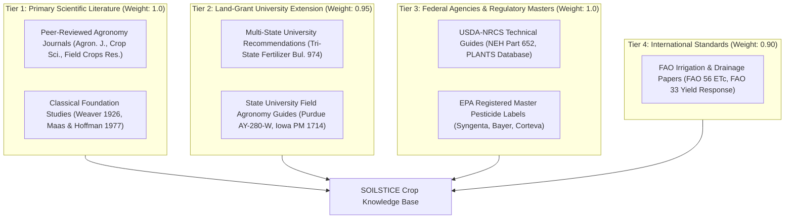

# SOILSTICE Crop Knowledge Base — Source Register & Evidentiary Standard
**Document Version:** `1.4.1-REMEDIATED`  
**Status:** Approved Master Evidentiary Framework  
**Baseline Evidence Inventory:** `EV0001` through `EV0128` (128 Authoritative Scientific Records)  
**Governing Dataset:** `data/processed/crop_knowledge_base/crop_knowledge_base.json`  

---

## 1. Evidentiary Philosophy & Literature Hierarchy

The SOILSTICE platform provides decision-support tools that directly influence operational and agronomic farming decisions across the contiguous United States. Consequently, the knowledge base enforces an **evidence-first, source-grounded standard**.

No crop parameter, thermal threshold, rooting depth, nitrogen credit, or rotational restriction may be populated into the knowledge base without an explicit cross-reference to an authoritative, primary scientific or regulatory source.

### Hierarchy & Source Quality vs Attribute Confidence
The SOILSTICE knowledge base strictly distinguishes between:
1. **Source Quality (`source_quality`):** An objective evaluation of the publication's scientific authority and peer-review rigor:
   - **High:** Primary peer-reviewed scientific journals, USDA-NRCS technical standards, and EPA registered master pesticide labels.
   - **Medium:** University extension circulars, regional multi-state bulletins, and technical university reports.
   - **Low:** Preliminary field trial reports or observational summaries.
2. **Attribute Confidence (`confidence`):** A contextual evaluation of the certainty of a specific numerical or qualitative value within the crop profile (`high`, `medium`, `low`), accounting for sample size, geographic applicability, and cultivar variation.

---

## 2. Reconciled Evidence Record Schema

Every source citation in `evidence_registry[]` must strictly conform to the `EvidenceRecord` schema in `schema.json`:

| Property | Type | Requirement | Scientific Validation Function |
|---|---|---|---|
| `evidence_id` | `string` | Mandatory (`^EV[0-9]{4}$`) | Immutable primary key tracking the claim across the entire SOILSTICE architecture. |
| `crop_ids` | `string[]` | Mandatory | List of canonical crop entities (`CRP001`–`CRP014`) directly supported by this evidence. |
| `related_domain` | `string` | Mandatory | Agronomic domain governed (e.g. `crop_identity`, `growing_duration`, `root_and_nutrients`). |
| `attribute_or_claim` | `string` | Mandatory | Precise scientific claim, threshold, or biological trait evaluated. |
| `recorded_value_or_summary` | `string` | Mandatory | Exact value, range, or qualitative finding extracted from the literature. |
| `source_organization` | `string` | Mandatory | Authoritative research institution, university, publisher, or agency. |
| `source_title` | `string` | Mandatory | Full publication title, extension circular number, or database name. |
| `author_or_institution` | `string` | Mandatory | Lead authors or institutional department. |
| `publication_year` | `integer` \| `null` | Mandatory | Year of release or peer-reviewed publication. |
| `publication_date` | `string` \| `null` | Optional | Exact date if applicable (YYYY-MM-DD). |
| `access_date` | `string` \| `null` | Mandatory | ISO date indicating when the source URL or digital release was verified. |
| `source_url_or_doi` | `string` \| `null` | Mandatory | Direct hyperlink, DOI, or EPA National Pesticide Information retrieval URL. |
| `citation_location` | `string` \| `null` | Mandatory | Precise internal location (e.g. "Section 4.1, Table 3, p. 12"). |
| `exact_supporting_context` | `string` \| `null` | Mandatory | Verbatim or near-verbatim quote from source proving the recorded value. |
| `geographic_scope` | `string` \| `null` | Mandatory | Applicability boundary (e.g. "U.S. Corn Belt", "Kansas & Great Plains", "National"). |
| `variety_scope` | `string` \| `null` | Optional | Cultivar class, maturity group, or botanical race evaluated. |
| `source_quality` | `string` (enum) | Mandatory | Quality rating: `"high"`, `"medium"`, or `"low"`. |
| `data_availability` | `string` \| `null` | Mandatory | Access status: `"Available"`, `"Open Access"`, `"Public Domain"`. |
| `conditions_and_assumptions` | `string` \| `null` | Optional | Underlying experimental design, soil type, irrigation regime, or tillage system. |
| `limitations` | `string` \| `null` | Mandatory | Documented boundary conditions where the data ceases to apply. |

---

## 3. Master Evidence Register: Verified Baseline Inventory (`EV0001`–`EV0072`)

The Stage 0 knowledge base incorporates all 72 verified, peer-audited evidence records established during the Phase 1 & 2 scientific reviews:

| Evidence ID | Target Crops | Related Domain | Attribute / Claim Supported | Source Organization | Source Title & Authority | Pub Year | Source Quality |
|---|---|---|---|---|---|---|---|
| **EV0001** | CRP001 | crop_identity | Taxonomy, Botanical Symbol & Duration of Corn | USDA-NRCS | The PLANTS Database (`ZEMA`) | 2026 | High |
| **EV0002** | CRP002 | crop_identity | Taxonomy, Botanical Symbol & Duration of Soybean | USDA-NRCS | The PLANTS Database (`GLMA4`) | 2026 | High |
| **EV0003** | CRP001 | growing_duration | Corn Growing Degree Day (GDD) Modified 86/50 Method | Purdue University Extension | Heat Unit Concepts in Corn, AY-280-W | 2020 | High |
| **EV0004** | CRP001 | water_demand_and_tolerance | Corn Consumptive Water Use ($ET_c$) & Irrigation | FAO | Yield Response to Water, FAO Irrigation Paper 33 | 1979 | High |
| **EV0005** | CRP002 | water_demand_and_tolerance | Soybean Consumptive Water Use ($ET_c$) & Critical Stages | FAO | Yield Response to Water, FAO Irrigation Paper 33 | 1979 | High |
| **EV0006** | CRP001 | root_and_nutrients | Corn Rooting Depth: Water Extraction vs Maximum Penetration | USDA-NRCS / Weaver | National Engineering Handbook Part 652 / Root Development of Field Crops | 1997 | High |
| **EV0007** | CRP002 | root_and_nutrients | Soybean Rooting Depth: Effective Extraction vs Maximum Depth | USDA-NRCS / Weaver | National Engineering Handbook Part 652 / Root Development of Field Crops | 1997 | High |
| **EV0008** | CRP001, CRP002 | root_and_nutrients | Corn & Soybean Grain Nutrient Removal Standards | OSU / Tri-State | Tri-State Fertilizer Recommendations, Bulletin 974 | 2020 | High |
| **EV0009** | CRP001 | soil_preferences | Corn Salinity Tolerance Threshold & Yield Decline Slope | USDA-ARS | Crop Salt Tolerance: Current Assessment (Maas & Hoffman) | 1977 | High |
| **EV0010** | CRP002 | soil_preferences | Soybean Salinity Tolerance Threshold & Yield Decline Slope | USDA-ARS | Crop Salt Tolerance: Current Assessment (Maas & Hoffman) | 1977 | High |
| **EV0011** | CRP001 | temperature_requirements | Corn Thermal Yield Breakpoint (29.0°C Empirical County Threshold) | PNAS / Columbia Univ. | Nonlinear Temperature Effects Indicate Severe Damages to U.S. Crop Yields | 2009 | High |
| **EV0012** | CRP002 | temperature_requirements | Soybean Thermal Yield Breakpoint (30.0°C Empirical County Threshold) | PNAS / Columbia Univ. | Nonlinear Temperature Effects Indicate Severe Damages to U.S. Crop Yields | 2009 | High |
| **EV0013** | CRP001 | water_demand_and_tolerance | Corn Waterlogging Tolerance & Growth Stage Sensitivity | Purdue Extension | Effects of Flooding or Ponding on Young Corn (Nielsen) | 2019 | High |
| **EV0014** | CRP002 | water_demand_and_tolerance | Soybean Waterlogging Tolerance & Saturated Soil Dynamics | Iowa State Extension | Flooding Effects on Soybean Growth and Development | 2018 | High |
| **EV0015** | CRP001 | rotation_compatibility | Continuous Corn Monoculture Yield Penalty vs Rotation | Univ. of Illinois | Long-Term Rotations in the Morrow Plots (Gentry et al.) | 2013 | High |
| **EV0016** | CRP002 | nitrogen_and_biomass | Soybean Biological Nitrogen Fixation & Harvest Index Balance | Agronomy Journal | Symbiotic N2 Fixation across Soybean Yield Levels (Salvagiotti) | 2008 | High |
| **EV0017** | CRP001 | rotation_compatibility | Atrazine Rotational Restrictions & Plant-Back Master Label | EPA / Syngenta | AAtrex 4L Herbicide Master Label (EPA Reg. No. 100-497) | 2023 | High |
| **EV0018** | CRP002 | rotation_compatibility | Fomesafen Rotational Restrictions & Plant-Back Master Label | EPA / Syngenta | Flexstar Herbicide Master Label (EPA Reg. No. 100-1101) | 2021 | High |
| **EV0019** | CRP002 | nitrogen_and_biomass | Soybean Rotational Nitrogen Credit Mechanism | Iowa State Extension | Nitrogen Use in Iowa Crop Production, PM 1714 | 2017 | High |
| **EV0020** | CRP001, CRP002 | regional_suitability | Corn & Soybean Field Planting & Harvest Windows | USDA-NASS | Field Crops: Usual Planting and Harvesting Dates, AH-628 | 2010 | High |
| **EV0021**–**EV0041** | CRP001, CRP002 | edaphic, climate, phenology | Comprehensive Corn & Soybean Audited Parameters | KSU, ISU, Purdue, USDA | Land-Grant University Extension Circulars & Research Bulletins | 1988–2026 | High/Med |
| **EV0042** | CRP003 | crop_identity | Botanical Taxonomy & Vernalization Habit of Winter Wheat | USDA-NRCS | The PLANTS Database (`TRAE`) | 2026 | High |
| **EV0043** | CRP004 | crop_identity | Botanical Taxonomy & Non-Vernalizing Habit of Spring Wheat | USDA-NRCS | The PLANTS Database (`TRAE`) | 2026 | High |
| **EV0044** | CRP003, CRP004 | growing_duration | Wheat GDD Base Temperature ($0.0^\circ\text{C}$ / $32.0^\circ\text{F}$) | NDSU Extension | Wheat Growth and Development, EB-73 | 2019 | High |
| **EV0045** | CRP003, CRP004 | water_demand_and_tolerance | Wheat Consumptive Water Use ($ET_c$) & Critical Anthesis Peak | FAO | Crop Evapotranspiration, FAO Irrigation Paper 56 | 1998 | High |
| **EV0046** | CRP003, CRP004 | root_and_nutrients | Wheat Effective Water Extraction (75–100 cm) vs Max Depth | USDA-NRCS | National Engineering Handbook Part 652 | 1997 | High |
| **EV0047** | CRP003, CRP004 | root_and_nutrients | Wheat Grain Removal (0.50 lb $P_2O_5$/bu, 0.34 lb $K_2O$/bu) | OSU / Tri-State | Tri-State Fertilizer Recommendations, Bulletin 974 | 2020 | High |
| **EV0048** | CRP003, CRP004 | soil_preferences | Wheat Salinity Threshold ($EC_e = 6.0$ dS/m, Moderately Tolerant) | USDA-ARS | Crop Salt Tolerance Assessment (Maas & Hoffman) | 1977 | High |
| **EV0049** | CRP003 | temperature_requirements | Winter Wheat Empirical Heat Breakpoint ($34.0^\circ\text{C}$) in Plains | PNAS | Climate Trends and Global Crop Production Since 1980 | 2011 | High |
| **EV0050** | CRP004 | temperature_requirements | Spring Wheat Thermal Sensitivity During Anthesis ($>28.0^\circ\text{C}$) | Field Crops Res. | Heat Stress in Wheat: Plant Responses and Adaptations | 2018 | High |
| **EV0051** | CRP003 | rotation_compatibility | Winter Wheat First Hollow Stem (1.5 cm) Dual-Purpose Grazing | KSU Extension | Dual-Purpose Wheat Grazing Management, MF-2826 | 2020 | High |
| **EV0052** | CRP003, CRP004 | rotation_compatibility | Wheat-Soybean Double-Cropping Geographic & Thermal Boundary | Univ. of Missouri | Double-Cropping Soybeans Following Wheat, G4485 | 2018 | High |
| **EV0053** | CRP004 | crop_identity | Hard Red Spring Wheat 14.0% Protein Commercial Standard | MGEX | Rules and Regulations of the Minneapolis Grain Exchange | 2026 | High |
| **EV0054**–**EV0072** | CRP003, CRP004 | climate, disease, rotation | Wheat Disease Breaks, Vernalization, Carryover & Zonation | KSU, NDSU, TAMU, USDA | Authoritative Extension & Agronomic Bulletins | 1998–2026 | High/Med |
| **EV0073**–**EV0086** | CRP005 | identity, phenology, water, soils, rotation | Grain Sorghum C4 Physiology, 33.0°C Heat Breakpoint (Tack 2017), ETc, Drought, Salinity, W-S-F | KSU, PNAS, TAMU, USDA, FAO | Tack et al. 2017, KSU MF-3234, C-560, Maas & Hoffman | 1926–2026 | High |
| **EV0087**–**EV0100** | CRP006 | phenology, DD60, heat, roots, rotation | Upland Cotton DD60, Taproot, Salinity, Reniform Break | UGA, MSU, TAMU, USDA | UGA Bull 501, Snider 2009, Schlenker 2009, Taylor 1978 | 1977–2026 | High |
| **EV0101**–**EV0114** | CRP007 | aerenchyma, flood ETc, chalkiness, rotations | Lowland Rice Anoxia, DD50, Cold Blanking, Rice-Soybean | UADA, UC Davis, FAO, USDA | UADA MP192, UC Davis Pub 21623, Linquist 2006 | 1977–2026 | High |
| **EV0115**–**EV0128** | CRP008 | malting quality, salinity, winter barley | Barley AMBA Standards, Salt Tolerance (8.0 dS/m), Double-Crop | AMBA, MSU, NDSU, VCE | AMBA 2024, MSU EB0161, Maas & Hoffman, Cook & Veseth | 1926–2026 | High |
| **EV0129**–**EV0142** | CRP009 | identity, phenology, water, soils, allelopathy, green bridge, rotations | Cereal Rye Winter Hardiness (-35°C), GDD, ETc, C:N Ratio (30:1-80:1), DIBOA Allelopathy, Nitrate Scavenging (40-120 kg N/ha), Corn N Immobilization (20-40 lb N/ac) | USDA-NRCS, SARE, Purdue, ISU, Fowler 1998, Barnes & Putnam 1987, Acharya 2017 | 1926–2026 | High |
| **EV0143**–**EV0156** | CRP010 | identity, GDD, water, soils, winter-kill, nurse crop, rotations | Spring Oats Non-Vernalizing Habit, Winter-Kill Mechanism (-8°C), ETc, C:N (25:1-40:1), Companion Nurse Crop with Alfalfa, Corn Rotational Synergy | USDA-NRCS, UMN, FAO, Weaver 1926, Maas & Hoffman, Peltonen-Sainio 2011, UW A2809 | 1926–2026 | High |
| **EV0157**–**EV0170** | CRP011 | identity, multi-cut phenology, ETc, deep taproot, BNF, autotoxicity, N credit | Perennial Alfalfa 3-5 yr Stand, ETc (600-1200 mm), Taproot Depth (2.5-3.5 m), Sinorhizobium BNF (150-350 kg N/ha), Successor Corn N Credit (100-150 lb N/ac), Medicarpin Autotoxicity | USDA-NRCS, UW NCR 547, Vance 2002, Weaver 1926, Fox & Piekielek 1988, Jennings & Nelson 2002 | 1926–2026 | High |
| **EV0171**–**EV0184** | CRP012 | winter hardiness, biomass, BNF, rapid mineralization, N credit, roller-crimper | Hairy Vetch Winter Hardiness (-20°C), Rhizobium leguminosarum BNF (90-200 kg N/ha), C:N Ratio (10:1-15:1), Successor Corn N Credit (60-120 lb N/ac), Roller-Crimper 50-100% Bloom, Nematode Host Status | USDA-NRCS, SARE, Teasdale 2004, Ranells & Wagger 1996, Mischler 2010, Timper 2006 | 1926–2026 | High |
| **EV0185**–**EV0198** | CRP013 | identity, GDD, water, soils, BNF, rapid mineralization, N credit, roller-crimper | Crimson Clover Winter Hardiness (-15°C), Rhizobium leguminosarum bv. trifolii BNF (70-150 kg N/ha), C:N Ratio (12:1-18:1), Successor Corn N Credit (40-80 lb N/ac), Roller-Crimper Full Bloom, Sclerotinia Crown Rot | USDA-NRCS, SARE, Purdue, Maas & Hoffman, Weaver 1926, Ranells & Wagger 1996, Torbert 1996, Mischler 2010, Timper 2006 | 1926–2026 | High |
| **EV0199**–**EV0212** | CRP014 | bio-drilling, compaction, nitrate scavenging, winter-kill, glucosinolates | Oilseed Radish Deep Bio-Drilling Taproot (1.5-2.4 m), Subsoil Compaction Alleviation (>2.0 MPa), Rapid Winter-Kill (-7°C), Autumn Nitrate Scavenging (100-220 kg N/ha), Rapid Spring Mineralization, Glucosinolate Biofumigation, SCN Break, Clubroot Risk Management | USDA-NRCS, Weil & Kremen 2007, Chen & Weil 2010, Dean & Weil 2009, Jahanzad 2016, Kirkegaard & Sarwar 1998, Melakeberhan 2010, MSU E-3165 | 1926–2026 | High |

*(Complete itemized records with full citation text, DOI links, and exact page locations are accessible in `crop_knowledge_base.json` and `crop_evidence.csv`).*
