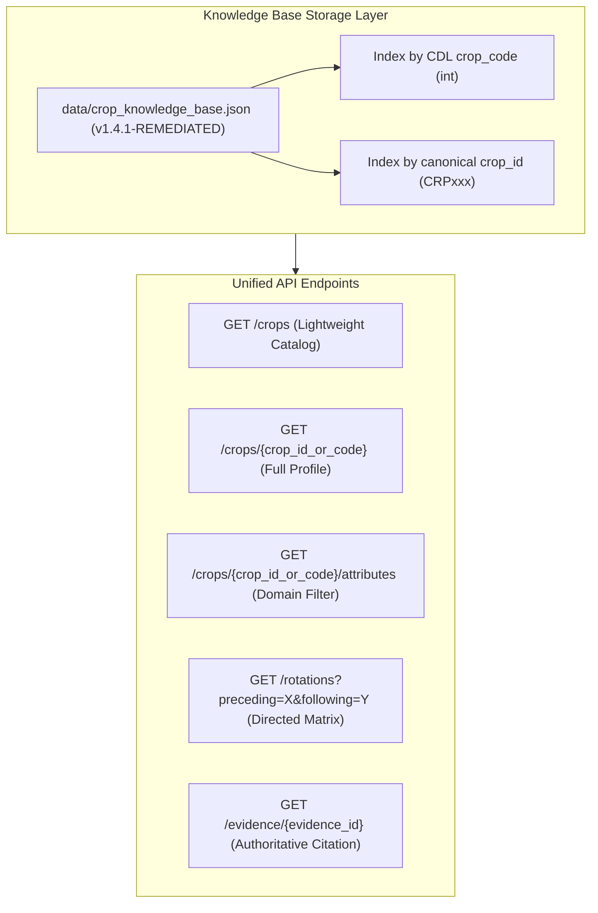

# SOILSTICE — Phase 5 Preparation: API Contract Compatibility & Backend Audit Report

**Document Version:** `1.0.0`  
**Evaluation Target:** Teammate `API_DATA_CONTRACT.md` vs Existing SOILSTICE Backend Architecture  
**Package Root:** `E:\MY PROJECTS\Soilstice\data\backend_handoff\`  
**Target Phase:** Phase 5 — Crop Knowledge Base Integration  
**Auditor:** Antigravity Agentic Scientific Auditor  
**Audit Date:** 2026-11-14  

---

## 1. Executive Summary & Purpose

The teammate handoff package includes a proposed read-only API contract (`API_DATA_CONTRACT.md`) designed to expose the 14-crop knowledge base, directed rotation transitions, and bibliographic evidence to internal services and frontend clients.

This document conducts a rigorous comparative audit between the proposed contract and the **actual existing SOILSTICE production architecture** (`backend/app/api/routes.py`, `backend/app/contracts/`, `backend/app/rotation/`, and frontend `src/services/` / `src/types/contracts.ts`).

### Key Audit Finding:
While the proposed endpoints are semantically sound, **the proposed contract cannot be merged as-is without breaking existing frontend views, type contracts, and CDL integration**. Specifically:
1. **Response Envelopes Differ:** The proposed contract uses `{api_version, dataset_version, status, data}`, whereas SOILSTICE uses `{data, meta, errors}` (`ApiResponse[T]`).
2. **Identifier Types Collide:** The proposed contract uses string IDs (`"CRP001"`), whereas existing SOILSTICE crop history, scenarios, and candidate dropdowns use integer USDA Cropland Data Layer (CDL) codes (`CropCode = number`).
3. **Pydantic Model Collisions:** The existing `CropOption` model is a lightweight 5-field DTO, whereas the proposed contract assumes a full 11-domain `CropEntity`.
4. **URL Prefix Conventions:** The proposed contract specifies `/api/*`, whereas the SOILSTICE FastAPI application mounts domain routes directly at the root (`/crops`, `/farms`, `/fields`).

A non-breaking, backwards-compatible reconciliation strategy is defined below.

---

## 2. Endpoint-by-Endpoint Comparison Matrix

| Proposed Handoff Endpoint | Proposed Description | Existing SOILSTICE Endpoint | Current Existing Status | Compatibility & Gap Analysis |
|---|---|---|---|---|
| `GET /api/crops` | Returns 14 canonical crops with summary identities | `GET /crops` (in `routes.py:341`) | **Active in Production** | **Mismatch in Envelope & Schema:**<br>• Existing returns `ApiResponse[list[CropOption]]` where `CropOption` has `{crop_code: int, name, family, is_double_crop, kb_version}`.<br>• Proposed returns `{total_crops: 14, crops: [{crop_id: "CRP001", common_name, ...}]}`.<br>• Existing lacks `crop_id`, `scientific_name`, `lifecycle_class`, and `functional_roles`. |
| `GET /api/crops/{crop_id}` | Full 11-domain agronomic profile | *None* | **Does Not Exist** | **New Endpoint Required:**<br>• Must be added to `routes.py` as `GET /crops/{crop_id}`.<br>• Must return full `CropEntity` wrapped in `ApiResponse[CropEntity]`.<br>• Should support lookup by both `CRP001` and CDL integer code (e.g. `1`). |
| `GET /api/crops/{crop_id}/attributes` | Filtered subset by domain or attribute | *None* | **Does Not Exist** | **New Endpoint Required:**<br>• Must be added to `routes.py` as `GET /crops/{crop_id}/attributes`.<br>• Supports `domain` query param (e.g. `nitrogen_and_biomass`). |
| `GET /api/rotations?previous_crop={id}&next_crop={id}` | Directed pairwise transition ($A \to B$) | `GET /fields/{field_id}/recommendations`<br>`GET /fields/{field_id}/scenarios` | **Pending Engine / Scenario CRUD Active** | **New Standalone Endpoint Required:**<br>• Existing endpoints evaluate multi-year sequences in the context of a specific field.<br>• Proposed endpoint is a pure, field-agnostic knowledge lookup ($14 \times 14$ matrix).<br>• Should be added to `routes.py` as `GET /rotations`. |
| `GET /api/evidence/{evidence_id}` | Primary bibliographic evidence record (`EV0001`–`EV0212`) | `GET /fields/{field_id}/evidence` | **Active for Field Analytics** | **Complementary / New Global Endpoint:**<br>• Existing endpoint returns field-level analytical evidence items.<br>• Proposed endpoint retrieves global static bibliographic citations by `evidence_id`.<br>• Should be added as `GET /evidence/{evidence_id}`. |

---

## 3. Structural, Schema & Contract Discrepancies

### 3.1 Response Envelope Structure
SOILSTICE enforces a strict, typed API response envelope across all endpoints (`backend/app/contracts/envelope.py` and `src/types/contracts.ts`):

#### Existing SOILSTICE Production Envelope:
```json
{
  "data": { ... },
  "meta": {
    "request_id": "req_01J...",
    "timestamp": "2026-11-14T15:20:00Z",
    "environment": "production"
  },
  "errors": []
}
```

#### Proposed Handoff Envelope (`API_DATA_CONTRACT.md`):
```json
{
  "api_version": "1.0.0",
  "dataset_version": "1.4.1-REMEDIATED",
  "timestamp": "2026-11-14T15:20:00Z",
  "status": "success",
  "data": { ... }
}
```

**Discrepancy Resolution:**
All Phase 5 endpoints must adhere to the **SOILSTICE `ApiResponse[T]` envelope**. Dataset metadata (`dataset_version: "1.4.1-REMEDIATED"`, `api_version: "1.0.0"`) must be included inside the `meta` object or passed via HTTP response headers (`X-Dataset-Version: 1.4.1-REMEDIATED`), preserving full client compatibility.

---

### 3.2 Crop Identifier Typology (`CropCode` vs `crop_id`)

#### Existing SOILSTICE Typology:
- `CropCode = number` (integer USDA Cropland Data Layer raster codes: 1=Corn, 5=Soybeans, 24=Winter Wheat, 4=Sorghum, 36=Alfalfa, 26=Dbl Crop Wheat/Soybeans, 61=Fallow).
- Scenario sequences (`ScenarioYear`) enforce integer codes:
  ```typescript
  export interface ScenarioYear {
    year: number;
    crop_code: CropCode;
    crop_name: string;
  }
  ```
- Field crop history (`CropYear`) stores integer CDL class values from rasterio zonal stats.

#### Proposed Handoff Typology:
- `crop_id: string` matching regex `^CRP[0-9]{3}$` (`CRP001` to `CRP014`).
- Rotation transitions use `preceding_crop_id: "CRP014"`, `following_crop_id: "CRP001"`.

**The Conflict:**
If `GET /crops` is changed to return string `crop_id` instead of numeric `crop_code`:
1. Scenario creation (`POST /fields/{id}/scenarios`) fails schema validation.
2. The frontend scenario builder (`src/components/views/rotation-view.tsx`) will crash when selecting crops.
3. The TypeScript contract test (`npm run contract:check`) will immediately fail.

---

### 3.3 Data Model Granularity (`CropOption` vs `CropEntity`)

#### Existing `CropOption` (Lightweight DTO):
```python
class CropOption(BaseModel):
    crop_code: int
    name: str
    family: str
    is_double_crop: bool
    kb_version: str
```

#### Proposed `CropEntity` (Deep Knowledge Profile):
Contains 11 domains, over 100 properties, value objects (`QuantitativeAttribute`, `QualitativeAttribute`, `BooleanAttribute`), stage-dependent thresholds, and nested citation arrays.

**The Conflict:**
`CropOption` is used across the frontend in multiple select inputs, scenario tables, and overview cards. Returning a massive 80 KB `CropEntity` per crop on `GET /crops` would bloat payload sizes from 2 KB to > 1 MB, degrading dashboard performance.

---

## 4. Breaking Changes & Regression Analysis

If the proposed `API_DATA_CONTRACT.md` were implemented literally and naively:

1. **Frontend Contract Breakage:**
   `npm run contract:check` compares `contract/openapi.gen.ts` against backend FastAPI OpenAPI specs. Changing `/crops` signature or types without contract synchronization halts CI/CD builds.
2. **Scenario Evaluation Failure:**
   `backend/app/services/rotation.py:_sequence()` verifies:
   ```python
   if self.ctx.kb.crop_name(item.crop_code) is None:
       errors.append({"index": i, "crop_code": item.crop_code, "error": "unknown crop code"})
   ```
   If `CropKnowledgeBase` drops numeric `crop_code` indexing, all scenario validations fail.
3. **CDL Alignment Loss:**
   CDL zonal statistics produce raster integers (e.g. 1 for Corn). If the knowledge base does not map CDL integers to canonical `crop_id` strings, the link between remote sensing history and agronomic recommendations is broken.

---

## 5. Recommended Phase 5 Architectural Reconciliation Strategy

To achieve seamless, zero-regression integration, Phase 5 should execute the following architectural design:



### 5.1 Dual-Key Indexing in `CropKnowledgeBase`
Refactor `backend/app/rotation/kb.py` to maintain two lookup maps:
1. `by_id: dict[str, CropEntity]` (indexed by `"CRP001"`–`"CRP014"`).
2. `by_code: dict[int, CropEntity]` (indexed by USDA CDL integer codes: `1, 2, 3, 4, 5, 21, 23, 24, 27, 28, 36`).
3. For crops not natively isolated in CDL (e.g. Crimson Clover, Hairy Vetch, Oilseed Radish), assign synthetic negative or extended codes (e.g. `1012, 1013, 1014` or map to generic cover crop codes) while preserving their primary canonical `CRP012`–`CRP014` string IDs.

### 5.2 Non-Breaking Endpoint Design

#### 1. Enhanced `GET /crops` (Backwards-Compatible):
Augment the existing `CropOption` schema with non-breaking optional fields:
```python
class CropOption(BaseModel):
    crop_code: int                  # Existing integer (CDL)
    crop_id: str                    # New: "CRP001"
    name: str                       # Existing common name
    scientific_name: str            # New: "Zea mays L."
    family: str                     # Existing botanical family
    is_cover_crop: bool             # New flag
    is_double_crop: bool            # Existing flag
    portfolio_role: str             # New: "primary_commercial" | "rotation_cover"
    kb_version: str                 # "1.4.1-REMEDIATED"
```
This preserves 100% of existing frontend functionality while empowering new Phase 5 UI components with canonical IDs and botanical taxonomy.

#### 2. Implement `GET /crops/{crop_id_or_code}`:
Returns the full unflattened `CropEntity` (all 11 domains) wrapped in `ApiResponse[CropEntity]`. Accepts either `"CRP001"` or `1`.

#### 3. Implement `GET /crops/{crop_id_or_code}/attributes`:
Returns filtered sub-domains (e.g. `?domain=nitrogen_and_biomass`).

#### 4. Implement `GET /rotations`:
Exposes the 196 directed pairwise transitions. Supports either crop ID or integer code:
`GET /rotations?preceding=CRP014&following=CRP001` or `GET /rotations?previous_crop=14&next_crop=1`.

#### 5. Implement `GET /evidence/{evidence_id}`:
Returns the full bibliographic citation (`EV0001`–`EV0212`) wrapped in `ApiResponse[EvidenceRecord]`.

---

## 6. Parity Verification Roadmap

Before deploying Phase 5 code changes:
1. Run backend tests: `pytest backend/tests/` (verifying 0 regressions across existing 287 tests).
2. Export OpenAPI schema: `node contract/export-openapi.mjs`.
3. Verify contract parity: `npm run contract:check`.
4. Run frontend tests: `npm run test` and `npm run typecheck`.
