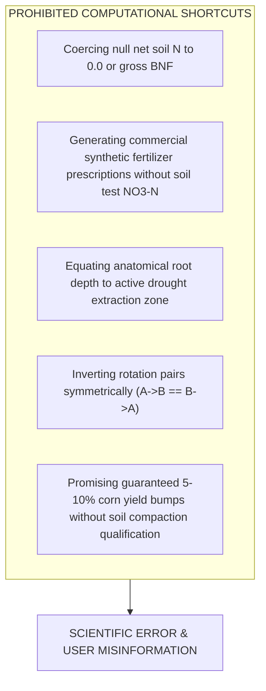

# SOILSTICE — Phase 5 Preparation: Scientific Constraints, Limitations & Agronomic Safeguards

**Document Version:** `1.0.0`  
**Evaluation Target:** Teammate Backend Handoff `SCIENTIFIC_LIMITATIONS.md` & Agronomic Data Model  
**Package Root:** `E:\MY PROJECTS\Soilstice\data\backend_handoff\`  
**Target Phase:** Phase 5 — Crop Knowledge Base Integration  
**Auditor:** Antigravity Agentic Scientific Auditor  
**Audit Date:** 2026-11-14  

---

## 1. Executive Summary & Epistemological Framework

The **SOILSTICE Crop Knowledge Base** provides authoritative agronomic and physiological intelligence designed to power downstream suitability evaluations (Phase 6) and multi-year rotation recommendations (Phase 7).

In agricultural data engineering, **computational precision must never outrun scientific validity**. Biological organisms operating in open environmental systems do not behave like deterministic mechanical components. Consequently, `SCIENTIFIC_LIMITATIONS.md` constitutes **mandatory scientific doctrine** for all future SOILSTICE development.

This report formalizes the five core scientific boundaries, null semantics, nitrogen accounting disciplines, hydrological distinctions, and prohibited calculations that backend engineers and recommendation algorithms must strictly enforce.

---

## 2. Strict Null Semantics & Serialization Rules

### 2.1 The Meaning of `null` vs `0.0`
In many commercial software systems, `null` is lazily treated as missing input, default zero, or an empty string. In SOILSTICE, **`null` represents an explicit epistemological boundary**:

| Value | Scientific Interpretation | Permissible Backend Behavior | Prohibited Action |
|---|---|---|---|
| `0.0` | **Measured Absence of Trait/Flux.** Verified biological zero (e.g. Corn biological $N_2$ fixation = $0.0\text{ kg N/ha}$; Radish BNF = $0.0\text{ kg N/ha}$). | Propagate `0.0` to arithmetic operations. | Do not convert to `null`. |
| `null` | **Scientifically Decoupled or Unmeasured.** The value cannot be stated as a single universal number without introducing ungrounded assumptions (e.g. whole-system net soil N balance under cover crops). | Preserve as JSON `null` / Python `None`. Surface limitation strings to users. | **NEVER coerce to `0.0`, `""`, `-999`, or arbitrary averages.** |

### 2.2 Intentional Null Instances in the Handoff
1. **Net Soil Nitrogen Balance in Green Manures (`CRP012`, `CRP013`, `CRP014`):**
   `net_soil_nitrogen_balance_kg_ha.value` is intentionally set to `null` for Hairy Vetch, Crimson Clover, and Oilseed Radish:
   - For grain crops (Corn, Soybeans, Wheat), net partial N flux is mathematically defined as:
     $$\Delta N_{\text{partial}} = \text{Gross Fixed } N_2 - \text{Harvest Export } N$$
   - In unharvested cover crops, harvest export is $0.0\text{ kg N/ha}$. If the formula were naively evaluated, net soil N balance would equal gross fixed $N_2$ ($90\text{--}200\text{ kg N/ha}$).
   - **The Scientific Trap:** In open field environments, unharvested legume biomass decomposes rapidly (C:N ratio 10:1–15:1). Up to 30–50% of the mineralized ammonium/nitrate can be lost through ammonia volatilization, denitrification, or winter/spring leaching before the subsequent crop's roots reach the subsoil. Equating gross fixation to net soil accumulation is a severe agronomic error. Setting the value to `null` prevents algorithms from treating green manure biomass as guaranteed permanent soil organic nitrogen.
2. **Biological Ranges Where Single Point Estimates Are Invalid:**
   In phenological duration (`active_growth_duration_days`), consumptive water use (`seasonal_consumptive_water_use_etc_mm`), and effective rooting depth (`effective_water_extraction_depth_cm`), the point estimate `value` is `null`, while `min_value` and `max_value` define the empirical range. Phenotypic plasticity and cultivar selection produce wide operational intervals; forcing a single midpoint creates false precision.
3. **Rainfed Systems:**
   `net_irrigation_requirement_mm` is `null` or `0.0` for cover crops managed strictly without irrigation.

### 2.3 Backend Serialization Mandate
- **Database / ORM Models:** SQLAlchemy or Pydantic models must define these fields as `Optional[float] = None`.
- **JSON Serialization:** JSON encoders must emit `"value": null`, NOT omit the key and NOT coerce to `0.0`.
- **API Consumers:** Frontend clients must check for `value === null` and render the empirical range (`[min_value, max_value]`) alongside the accompanying `limitations` string.

---

## 3. Nitrogen Accounting & Biological Dynamics

### 3.1 Gross Biological Fixation ($BNF$) $\neq$ Net Soil Enrichment
Symbiotic biological nitrogen fixation by rhizobia (*Rhizobium*, *Sinorhizobium*, *Bradyrhizobium*) captures atmospheric $N_2$, but the whole-system net nitrogen balance depends on the harvest index:

$$\Delta N_{\text{soil}} = (\text{Biomass } N \times \%Ndfa) - \text{Grain/Forage Harvest Export } N - \text{Environmental Losses}$$

- **Soybeans (`CRP002`):** Fixes $100\text{--}250\text{ kg N/ha}$ from the atmosphere ($\%Ndfa = 50\text{--}75\%$). However, high-protein soybean grain exports $150\text{--}220\text{ kg N/ha}$ of elemental nitrogen. Consequently, **the net soil nitrogen balance of grain soybeans is frequently neutral or negative ($-20\text{ to }+10\text{ kg N/ha}$)**. Soybeans do NOT enrich the soil with massive nitrogen reserves. The observed yield bump on subsequent corn is largely a rotational sanitation and mycorrhizal benefit, with an empirical rotational credit of only $20\text{--}40\text{ lb N/ac}$.
- **Alfalfa (`CRP011`):** Fixes $150\text{--}350\text{ kg N/ha}$. Commercial hay harvesting removes 4–6 cuts per year, exporting large quantities of nitrogen. However, upon stand termination, taproot and crown residue breakdown supplies a massive rotational credit of $100\text{--}150\text{ lb N/ac}$ to first-year corn.

### 3.2 Oilseed Radish (`CRP014`): Nitrate Scavenging vs Biological Addition
The handoff package explicitly remediates a widespread industry misconception regarding Brassica catch crops:
- **Biological Nitrogen Fixation:** Strictly `0.0 kg N/ha` (`has_symbiotic_fixation_capacity: false`). Radish belongs to the family Brassicaceae and forms zero symbiotic nodules.
- **Nitrate Scavenging (Internal Profile Recycling):** Radish roots capture **$100\text{--}220\text{ kg N/ha}$ ($90\text{--}200\text{ lb N/ac}$)** of residual soil mineral nitrate ($NO_3^-\text{--N}$) that would otherwise leach into groundwater.
- **Fertilizer Equivalent Credit:**
  - `fertilizer_equivalent_n_credit_lb_ac.value` is strictly **`0.0 lb N/ac`** (zero net biological addition to the farm system).
  - Effective Rotational Benefit: **$20\text{--}40\text{ lb N/ac}$** under specific conditions, because scavenged nitrogen is recycled into succulent, low C:N (10:1–15:1) tissue that decomposes rapidly upon winter-kill.
- **The Spring Leaching Hazard:** Radish winter-kills at $-7.0^\circ\text{C}$ to $-9.0^\circ\text{C}$ in December/January. Biomass collapses and mineralizes rapidly in early spring (March–April). On coarse sandy soils with high spring precipitation, this released nitrate will leach below 1 meter before corn root systems establish in late May/June. Recommendation engines **must warn farmers to pair radish with an overwintering grass (such as cereal rye)** on well-drained sandy soils to capture early spring mineralized nitrogen.

### 3.3 Carbon-to-Nitrogen ($C:N$) Ratio and Microbial Immobilization
The handoff provides empirical C:N ratios that dictate residue breakdown rates:
- **Low C:N (< 20:1):** Hairy Vetch (10:1–15:1), Crimson Clover (12:1–18:1), Radish (10:1–15:1). Rapid mineralization occurs within 2–4 weeks of termination, releasing mineral nitrogen.
- **Moderate C:N (20:1–30:1):** Soybean residue (25:1–35:1), Oats (25:1–40:1). Near the critical threshold; neutral to slight immobilization followed by mineralization.
- **High C:N (> 30:1):** Corn stover (55:1–65:1), Wheat straw (70:1–85:1), Mature Cereal Rye (40:1–80:1). Soil microbes consume available soil mineral nitrogen to decompose high-carbon residue, causing temporary **nitrogen immobilization**.
- **Management Rule:** Subsequent corn following high-biomass cereal rye requires an additional $20\text{--}40\text{ lb N/ac}$ of early starter nitrogen at planting to overcome microbial immobilization.

---

## 4. Root Architecture & Depth Modeling Rules

### 4.1 Disaggregation of Active Extraction Depth vs Anatomical Depth
The dataset enforces a strict separation between two fundamentally distinct rooting metrics:

| Metric | Schema Field | Typical Depth Range | Agronomic & Hydrological Meaning |
|---|---|---|---|
| **Effective Water Extraction Depth** | `effective_water_extraction_depth_cm` | $40\text{--}120\text{ cm}$ | The active root zone containing **$\ge 80\%$ of functional moisture and nutrient uptake**. Used for daily irrigation scheduling, drought stress index calculation, and available water capacity (AWC) modeling. |
| **Maximum Anatomical Root Depth** | `maximum_anatomical_root_depth_cm` | $120\text{--}350\text{ cm}$ | The deepest observed vertical penetration of individual pioneer taproots or nodal roots in deep, unconstrained, friable loess or alluvium. |

### 4.2 Soil Mechanical Resistance & Compaction Boundaries
- **Plow Pan Truncation:** If a soil horizon has bulk density $> 1.55\text{--}1.65\text{ g/cm}^3$ or penetration resistance $> 2.0\text{--}2.5\text{ MPa}$, crop roots cannot penetrate vertically and deflect horizontally. Under compacted conditions, **actual root depth collapses to the plow layer ($15\text{--}25\text{ cm}$)** regardless of the crop's genetic potential.
- **Radish Bio-Drilling Potential:** Oilseed Radish (`CRP014`) exerts root axial penetration forces capable of penetrating compacted subsoils ($> 2.0\text{ MPa}$), creating cylindrical macropores (biopores) that subsequent corn roots follow (Chen & Weil 2010; `EV0202`).
- **Operational Limitations of Bio-Drilling:** Radish taproot alleviation **fails completely** if:
  1. Soil is severely smeared or waterlogged (anaerobic conditions prevent growth).
  2. Fall seeding occurs $< 6\text{--}8\text{ weeks}$ before the first killing freeze (radish lacks thermal time to develop a $> 1\text{ cm}$ taproot).

---

## 5. Crop Rotation Caveats & Transition Matrix Dynamics

### 5.1 Directional Asymmetry ($A \to B \neq B \to A$)
In agricultural rotations, transitions are inherently non-reciprocal. Preceding crops alter soil moisture reserves, residual nitrate, allelopathic chemical concentrations, and pest reservoirs:
- **Radish $\to$ Corn (`CRP014` $\to$ `CRP001`):** Rated **`highly_compatible`**. Radish bio-drilling alleviates compaction; non-host status breaks corn rootworm; winter-kill eliminates mechanical termination costs.
- **Corn $\to$ Radish (`CRP001` $\to$ `CRP014`):** Rated **`compatible`**. Standard sequence, but carries herbicide carryover risks (e.g. residual atrazine applied to corn can kill emerging radish seedlings if plant-back intervals $< 10\text{--}12\text{ months}$ are violated).

### 5.2 Simultaneous Polyculture Mixtures $\neq$ Sequential Monocultures
- **Crimson Clover + Oilseed Radish (`CRP013` + `CRP014`):**
  - As a **simultaneous companion cover crop mixture**, clover and radish are highly synergistic: radish establishes rapidly and scavenges nitrogen, while clover overwinters and provides spring nitrogen.
  - As a **sequential monoculture rotation** (`CRP013` $\to$ `CRP014` or `CRP014` $\to$ `CRP013`), planting one cool-season annual cover crop immediately after another leaves the summer growing season vacant, resulting in severe economic loss and weed proliferation.
  - The handoff correctly rates the sequential transition as **`caution_conditional`** and includes explicit `[MIXTURE NOTE]` tags explaining this distinction.

### 5.3 Continuous Monoculture Yield Penalties
The handoff details continuous monoculture risks across all 14 crops (`is_monoculture: true`):
- **Corn on Corn (`CRP001` $\to$ `CRP001`):** Suffers an empirical **$5\%\text{ to }15\%$ yield penalty** compared to rotated corn across the U.S. Corn Belt, regardless of nitrogen fertilizer rate (Morrow Plots; Gentry et al. 2013; `EV0015`).
- **Continuous Soybeans (`CRP002` $\to$ `CRP002`):** Causes exponential buildup of Soybean Cyst Nematode (*Heterodera glycines*) and soil-borne fungal pathogens (*Fusarium virguliforme*, *Phytophthora sojae*).
- **Continuous Wheat (`CRP003` $\to$ `CRP003`):** Increases vulnerability to Take-All root rot (*Gaeumannomyces graminis*) and Cephalosporium stripe.

### 5.4 Biological Disease Management $\neq$ Statutory Quarantine Prohibitions
- **Brassica Clubroot (*Plasmodiophora brassicae*):** Repeated brassica plantings can foster clubroot. In the handoff, this is classified as an epidemiological disease management challenge (`caution_conditional`), requiring $\ge 3\text{--}4\text{ year}$ rotation intervals in infested fields.
- **Statutory Prohibitions (`prohibited`):** The `prohibited` rating is reserved exclusively for legally binding restrictions (e.g. EPA-mandated herbicide plant-back restrictions where rotation is illegal under federal pesticide law, or state agricultural quarantine orders). Zero statutory prohibitions exist across the canonical baseline matrix.

---

## 6. Prohibited & Unsupported Calculations

To maintain scientific integrity and prevent producer liability, the following computations are **strictly prohibited** in SOILSTICE:

1. **NO Commercial Fertilizer Prescriptions:**
   SOILSTICE must never output commercial synthetic nitrogen application recommendations based solely on knowledge base values. Nitrogen fertilizer rates must be governed by site-specific soil nitrate tests ($NO_3^-\text{--N}$), university MRTN (Maximum Return to Nitrogen) calculators, or local yield goals.
2. **NO Speculative Soil Carbon Sequestration Modeling:**
   Dry matter biomass ($kg/ha$) and C:N ratios provide relative residue cover comparisons. They cannot be converted into verified soil organic carbon ($SOC$) credits without local temperature, moisture, tillage, and microbial decomposition dynamics.
3. **NO Yield Guarantees:**
   Synergies such as the "5–10% corn yield increase following radish" (`EV0202`) are site- and climate-conditional (observed on compacted soils under late-season moisture stress). On deep, uncompacted soils, zero yield increase is observed. All frontend presentations must include conditional disclosures.
4. **NO Symmetrical Rotation Reversals:**
   Algorithms must never assume that because $A \to B$ is `highly_compatible`, $B \to A$ shares the same rating or mechanisms.
