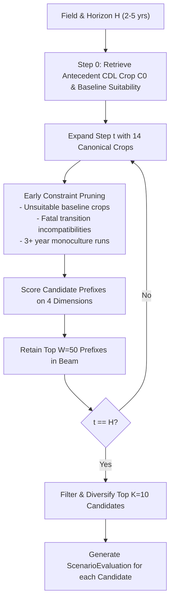

# SOILSTICE — Phase 7: Multi-Year Crop Rotation Architecture and Scientific Specification
**Document Version:** 1.0.0  
**Phase:** 7 (Multi-Year Crop Rotation Recommendation & Scenario Comparison Engine)  
**Status:** Canonical Architectural & Scientific Specification  
**Effective Date:** 2026-11-15  

---

## 1. Executive Summary & Objective

The **SOILSTICE Phase 7 Multi-Year Crop Rotation Engine** provides an evidence-based decision-support system that generates, evaluates, explains, and compares multi-year crop sequences for agricultural parcels in Reno and Finney counties, Kansas.

Phase 7 builds directly upon the scientific foundations established in prior phases:
- **Phase 4:** Multi-source environmental observation pipelines (NASA POWER agroclimatology, SSURGO soil surveys, USGS/SRTM topography, USDA CDL crop history).
- **Phase 5:** Cited Crop Knowledge Base (`data/crop_knowledge_base.json`), cataloging physiological thresholds, botanical taxonomy, and 196 directed rotation compatibility transitions with 212 peer-reviewed evidence citations (`EV0001`–`EV0212`).
- **Phase 6:** Crop Suitability Engine, providing factor-by-factor biophysical suitability evaluations governed by Liebig's Law of the Minimum across the 14 canonical crops (`CRP001`–`CRP014`).

### 1.1. Core Problem Statement
In semiarid and subhumid Great Plains agroecosystems (e.g. South-Central and Western Kansas), single-year crop choices cannot be made in isolation. A crop chosen in year $t$ profoundly alters:
1. **Residual soil water profile:** Depletion of deep soil moisture reserves by heavy-consumption taproot crops vs shallow moisture conservation by short-season crops or fallow/cover cycles.
2. **Pest and disease cycles:** Carryover of soil-borne fungi (e.g. *Fusarium*, *Rhizoctonia*, *Macrophomina phaseolina*), nematodes, and insect pests when botanically related crops are planted consecutively.
3. **Herbicide carryover and rotational restrictions:** Residual sulfonylureas, imidazolinones, or triazines from previous applications restricting subsequent broadleaf or sensitive cereal establishment.
4. **Weed suppression and residue management:** Dense residue cover (e.g. winter wheat or sorghum stubble) conserving moisture and reducing evaporative loss for subsequent summer crops.

Phase 7 bridges single-year environmental suitability with temporal sequence intelligence, empowering producers and agronomists to evaluate 2- to 5-year crop rotation trajectories.

### 1.2. Strict Scope Boundaries & Prohibitions
To ensure scientific integrity and prevent deceptive precision, the following boundaries are strictly enforced:
- **NO Yield Forecasting:** The engine does not predict metric tons or bushels per acre.
- **NO Financial or Profit Optimization:** Commodity market prices, input costs, and net margin forecasts are outside scope.
- **NO Fabricated Nitrogen Credits:** The engine does not synthesize unverified numerical nitrogen credit deductions (e.g. "40 lbs N/acre") or replace field-calibrated soil tests.
- **NO Dynamic Soil Chemistry Simulation:** The engine does not run complex numerical differential equation solvers (e.g. DSSAT, APSIM, Century) for daily carbon/nitrogen turnover.
- **NO Future Weather Simulation:** Future weather is not forecasted; evaluations utilize verified historical agroclimatic baselines and documented crop physiological water/heat demands.
- **NO Intercropping / Relay Cropping:** Sequences represent annual primary or cover crop sequences per season window.

---

## 2. Core Agronomic & Scientific Foundations

### 2.1. Directed Rotation Asymmetry
Crop rotation compatibility is inherently **directed and asymmetric**:
$$T(C_{\text{prev}} \rightarrow C_{\text{next}}) \neq T(C_{\text{next}} \rightarrow C_{\text{prev}})$$

For example:
- **Alfalfa (`CRP010`) $\rightarrow$ Corn (`CRP001`):** *Recommended.* Alfalfa breaks corn rootworm cycles, improves soil aggregate structure via deep taproots, and provides substantial organic nitrogen carryover.
- **Corn (`CRP001`) $\rightarrow$ Alfalfa (`CRP010`):** *Caution / Marginal.* Corn requires heavy herbicide programs that often carry over and impair small-seeded perennial legume seedling emergence; high nitrogen residue can also favor aggressive annual weed competition over young alfalfa.
- **Soybean (`CRP002`) $\rightarrow$ Winter Wheat (`CRP003`):** *Recommended.* Early-maturing soybean harvest allows timely autumn drilling of winter wheat into a firm, moist seedbed with minimal tillage.
- **Winter Wheat (`CRP003`) $\rightarrow$ Soybean (`CRP002`):** *Acceptable/Caution depending on moisture.* Requires double-crop timing or spring planting with sufficient moisture recharge.

The Phase 7 engine utilizes the complete **196 directed transition matrix** from the Phase 5 Knowledge Base (`crop_rotation_compatibility.csv`), preserving specific synergy mechanisms, pathogen risks, herbicide warnings, and evidence citations (`EV0001`–`EV0212`).

### 2.2. Handling Antecedent Field Context (CDL History Linkage)
Year 1 of any prospective rotation scenario does not occur in an agronomic vacuum; it is conditioned by the actual crops cultivated on the parcel in preceding years.

The Phase 7 engine retrieves the field's Cropland Data Layer (CDL) majority crop history (from Phase 4):
1. **Preceding Year Context ($t_0$):** The verified majority crop from the most recent historical season (e.g. 2025) serves as $C_0$ for evaluating the first year ($C_1$) of the prospective scenario.
2. **5-Year Historical Frequency:** Frequency of crops in the prior 5 years is calculated to detect extended monoculture or historical lack of diversity.
3. **Unknown Preceding Context Handling:** When antecedent CDL data is missing or indeterminate, the $C_0 \rightarrow C_1$ transition is labeled `unknown` with an informative warning, and the engine **never fabricates an unearned rotational synergy or penalty**.

### 2.3. Botanical Family Repetition & Pathogen Dynamics
Consecutive planting of crops from the same botanical family amplifies species-specific pathogens, root rots, and insect pressures. The 14 canonical crops are classified into four botanical families:

| Botanical Family | Canonical Crops | Key Pathogen & Agronomic Concerns |
| :--- | :--- | :--- |
| **Poaceae (Gramineae)** | Corn (`CRP001`), Winter Wheat (`CRP003`), Spring Wheat (`CRP004`), Grain Sorghum (`CRP005`), Rice (`CRP007`), Barley (`CRP008`), Cereal Rye (`CRP009`), Oats (`CRP010`) | *Fusarium* head blight / stalk rot carryover between corn and wheat; root rot complexes; grass weed escapes; excessive carbon-to-nitrogen ($C:N$) surface residue. |
| **Fabaceae (Leguminosae)** | Soybean (`CRP002`), Alfalfa (`CRP011`), Hairy Vetch (`CRP012`), Crimson Clover (`CRP013`) | *Rhizoctonia*, *Phytophthora*, *Sclerotinia sclerotiorum* (white mold); sudden death syndrome (*Fusarium virguliforme*); cyst nematodes (*Heterodera glycines*). |
| **Brassicaceae (Cruciferae)** | Oilseed Radish (`CRP014`) | Deep compaction alleviation, biofumigation, rapid autumn canopy; clubroot risk if cycled too frequently with crucifers. |
| **Malvaceae** | Cotton (`CRP006`) | *Verticillium* wilt, *Thielaviopsis basicola* (black root rot); low residue cover requiring protective cover or high-residue rotational partner to prevent wind erosion. |

**Evaluation Rules for Botanical Runs:**
- **Monoculture ($C_t = C_{t-1}$):** Strictly penalized. Consecutive planting of the same species receives a `caution` or `not_recommended` rotational band depending on the crop profile limitations.
- **Family Run Length $> 2$:** Three or more consecutive years in the same botanical family (e.g. Corn $\rightarrow$ Sorghum $\rightarrow$ Wheat) triggers a `ROTATIONAL_FAMILY_ACCUMULATION` warning due to chronic lack of a broadleaf/taproot biological break.
- **Family Run Length $> 3$:** Triggers a `not_recommended` rotation benefit band for that year.

### 2.4. Rotational Water Demand Sequencing
In the semi-arid climate of Western Kansas (Finney County, ~450–500 mm annual precip) and transition zone of South-Central Kansas (Reno County, ~750–800 mm annual precip), moisture is the primary limiting resource.

Crops are classified by seasonal water demand:
- **High Demand:** Corn (`CRP001`), Alfalfa (`CRP011`), Rice (`CRP007`).
- **Moderate Demand:** Soybean (`CRP002`), Winter Wheat (`CRP003`), Spring Wheat (`CRP004`), Cotton (`CRP006`), Barley (`CRP008`), Oats (`CRP010`).
- **Low / Drought Tolerant / Conservation:** Grain Sorghum (`CRP005`), Cereal Rye (`CRP009`), Hairy Vetch (`CRP012`), Crimson Clover (`CRP013`), Oilseed Radish (`CRP014`).

**Rotational Water Risk Formulations:**
- **Consecutive High-Demand Crops:** Planting high-water-demand crops back-to-back (e.g. Corn $\rightarrow$ Corn or Corn $\rightarrow$ Alfalfa) without an intervening low-demand or fallow/recharge period creates severe subsoil moisture depletion.
- **Moisture Recharge Alignment:** Following a deep-rooted, moisture-depleting crop with a drought-hardy or early-maturing crop (e.g. Wheat after Sorghum, or Sorghum after Wheat with a summer fallow/stubble catch) receives positive water-risk stability.

---

## 3. Four-Dimensional Evaluation Framework

Every prospective rotation scenario is evaluated along **four orthogonal agronomic dimensions**, preventing single-factor distortion:

```
                      ┌──────────────────────────────────────┐
                      │    Scenario Evaluation Dimensions    │
                      └──────────────────┬───────────────────┘
            ┌──────────────────┬─────────┴─────────┬──────────────────┐
            ▼                  ▼                   ▼                  ▼
     Agronomic Fit      Rotation Benefit       Water Risk         Diversity
     (Soil & Climate)    (Synergy & Breaks)  (Moisture Cycle)   (Crops & Families)
```

### 3.1. Dimension 1: Agronomic Fit (`agronomic_fit`)
- **Basis:** Evaluates the biophysical suitability of each crop in the sequence against the field's verified soil properties (pH, drainage, available water storage, slope) and climatic indicators (GDD, precipitation, heat stress) using the Phase 6 suitability engine.
- **Calculation:**
  - Evaluates individual suitability classes: $S(C_t) \in \{\text{suitable}, \text{conditionally\_suitable}, \text{limited\_suitability}, \text{unsuitable}, \text{insufficient\_data}\}$.
  - If any crop in the sequence is `unsuitable` due to a critical soil/climate limitation, the dimension is classified as `unsuitable`.
  - If all crops are `suitable`, dimension is `suitable`.
  - If crops are `conditionally_suitable` or `limited_suitability`, dimension is `marginal`.

### 3.2. Dimension 2: Rotation Benefit (`rotation_benefit`)
- **Basis:** Evaluates the directed transition compatibility ($C_{t-1} \rightarrow C_t$), disease break potential, and absence of monoculture across all years.
- **Calculation:**
  - Each transition is scored:
    - `recommended`: +1.0
    - `acceptable`: +0.5
    - `caution`: -0.5
    - `not_recommended`: -2.0
    - `unknown`: 0.0 (neutral, flagged with data warning)
  - Monoculture penalties: Each instance of consecutive same-crop planting deducts 1.5 points.
  - The aggregate score is normalized over horizon $H$:
    - $\text{Mean} \ge 0.6 \implies \text{suitable}$
    - $0.0 \le \text{Mean} < 0.6 \implies \text{marginal}$
    - $\text{Mean} < 0.0 \implies \text{unsuitable}$

### 3.3. Dimension 3: Water Risk (`water_risk`)
- **Basis:** Evaluates the temporal water balance and crop water demand sequencing relative to the field's precipitation regime and available water storage capacity.
- **Calculation:**
  - Flags sequences containing consecutive high-water-demand crops without moisture recharge.
  - Evaluates whether drought-prone regions (e.g. Finney County) include water-efficient crops (e.g. Sorghum, Wheat, Rye) rather than continuous high-demand summer crops.
  - Band assignment:
    - Balanced water demand sequencing: `suitable`
    - Moderate moisture pressure (e.g. 2 moderate crops in dry zone): `marginal`
    - Severe water deficit risk (e.g. continuous corn in rainfed western KS): `unsuitable`

### 3.4. Dimension 4: Diversity (`diversity`)
- **Basis:** Evaluates taxonomic richness, functional trait complementarity, and temporal variation across the planning horizon.
- **Calculation:**
  - Let $N_{\text{crops}} = |\text{distinct crops}|$ and $N_{\text{families}} = |\text{distinct botanical families}|$.
  - For Horizon $H \in \{2, 3\}$:
    - $N_{\text{crops}} \ge 2$ and $N_{\text{families}} \ge 2 \implies \text{suitable}$
    - $N_{\text{crops}} \ge 2$ and $N_{\text{families}} = 1 \implies \text{marginal}$
    - $N_{\text{crops}} = 1 \implies \text{unsuitable}$
  - For Horizon $H \in \{4, 5\}$:
    - $N_{\text{crops}} \ge 3$ and $N_{\text{families}} \ge 2 \implies \text{suitable}$
    - $N_{\text{crops}} \ge 2$ and $N_{\text{families}} \ge 2 \implies \text{marginal}$
    - $N_{\text{crops}} < 2$ or $N_{\text{families}} = 1 \implies \text{unsuitable}$

---

## 4. Overall Interpretation Synthesis & Qualitative Labels

To ensure clear communication without collapsing multidimensional nuances into an arbitrary single score, the engine computes:
1. Standard contract-compliant `FitBand` for `overall`:
   - `"suitable"`, `"marginal"`, `"unsuitable"`, `"unknown"`
2. Explicit qualitative interpretation label:
   - **`supported`:** All four dimensions are `suitable` or favorable, with no critical limitations, no consecutive monoculture, and verified positive transition benefits.
   - **`conditional`:** Agronomically viable, but contains manageable limitations (e.g. moderate water risk, a `caution` transition requiring herbicide washout observation, or one `marginal` dimension).
   - **`exploratory`:** Incorporates novel or cover crops (e.g. Radish, Hairy Vetch) that provide ecological benefits but lack extensive regional commercial history, or where minor data gaps exist.
   - **`not_recommended`:** Contains fatal biophysical limitations, severe directed incompatibilities (e.g. disease carryover), or prolonged monoculture.
   - **`insufficient_data`:** Environmental baseline or crop knowledge is incomplete, preventing a scientifically valid evaluation.

### 4.1. Mapping Matrix
| Overall Qualitative Label | Overall `FitBand` | Agronomic Fit | Rotation Benefit | Water Risk | Diversity |
| :--- | :--- | :--- | :--- | :--- | :--- |
| **`supported`** | `suitable` | `suitable` | `suitable` | `suitable` | `suitable` |
| **`conditional`** | `marginal` | $\ge \text{marginal}$ | $\ge \text{marginal}$ | $\ge \text{marginal}$ | $\ge \text{marginal}$ (at least one `marginal`) |
| **`exploratory`** | `marginal` | $\ge \text{marginal}$ | $\ge \text{marginal}$ | Any | Incorporates cover/specialty crop |
| **`not_recommended`**| `unsuitable`| Any is `unsuitable` | Any is `unsuitable` | Any is `unsuitable` | Any is `unsuitable` |
| **`insufficient_data`**| `unknown` | `unknown` | Any | Any | Any |

---

## 5. Candidate Generation Algorithm (Bounded Beam Search)

To generate optimal, agronomic multi-year crop sequences for a field over horizon $H \in \{2, 3, 4, 5\}$, the engine executes a deterministic **Bounded Beam Search**:

### 5.1. Algorithm Specification
- **Search Space:** $14^H$ potential sequences ($14^2 = 196$, $14^3 = 2,744$, $14^4 = 38,416$, $14^5 = 537,824$).
- **Beam Width ($W$):** 50 candidate prefixes retained per step $t \in [1, H]$.
- **Return Count ($K$):** Top 10 non-dominated, distinct sequences returned to the user.
- **Tie-Breaking:** Fully deterministic using canonical crop code ordering (`CRP001` < `CRP002` < ... < `CRP014`).



### 5.2. Early Constraint Pruning (Hard Rejection)
A prospective branch is pruned immediately if:
1. **Critical Environmental Incompatibility:** The candidate crop has an `unsuitable` suitability class on the field's baseline profile.
2. **Fatal Directed Transition:** The transition $C_{t-1} \rightarrow C_t$ is classified as `not_recommended` in the Phase 5 KB due to critical pathogen transfer or phytotoxicity.
3. **Monoculture Limit:** The candidate crop would produce a run of $\ge 3$ consecutive years of the same species ($C_t = C_{t-1} = C_{t-2}$).

### 5.3. Composite Ranking Objective
For candidate retention in the beam, prefixes are scored via a weighted multi-criterion objective:
$$\text{Score}(S) = w_{\text{fit}} \cdot \bar{S}_{\text{suit}} + w_{\text{rot}} \cdot \bar{R}_{\text{trans}} + w_{\text{div}} \cdot D_{\text{tax}} - P_{\text{monoculture}} - P_{\text{family\_run}}$$
Where:
- $\bar{S}_{\text{suit}}$: Average environmental suitability score of crops in prefix.
- $\bar{R}_{\text{trans}}$: Average transition synergy score (+1.0 for recommended, +0.5 for acceptable, -0.5 for caution).
- $D_{\text{tax}}$: Taxonomic diversity bonus (ratio of distinct families to horizon length).
- $P_{\text{monoculture}}$: Monoculture penalty (15 points for repeating previous crop).
- $P_{\text{family\_run}}$: Family repetition penalty (10 points for $> 2$ consecutive years in same botanical family).
- Weights: $w_{\text{fit}} = 0.40$, $w_{\text{rot}} = 0.35$, $w_{\text{div}} = 0.25$.

---

## 6. Scenario Comparison Architecture

The engine provides side-by-side comparison for **2 or 3 scenarios** (`POST /api/v1/fields/{field_id}/rotations/compare`), evaluating:
1. **Sequence Trajectories:** Visual crop sequence with CDL colors and standard abbreviations.
2. **Dimension-by-Dimension Matrix:** Side-by-side display of `agronomic_fit`, `rotation_benefit`, `water_risk`, and `diversity` bands.
3. **Key Trade-off Synthesis:**
   - Diversity differential (e.g. "Scenario A introduces 3 families vs 1 family in Scenario B").
   - Water demand comparison (e.g. "Scenario B reduces continuous summer irrigation pressure by inserting winter wheat").
   - Disease break advantages (e.g. "Scenario A breaks *Fusarium* stalk rot cycle with legume break").
4. **Overall Qualitative Alignment:** Clear distinction between `supported`, `conditional`, `exploratory`, and `not_recommended` sequences.

---

## 7. API Contracts & Endpoint Specifications

### 7.1. Candidate Generation Endpoint
- **Method & Route:** `POST /api/v1/fields/{field_id}/rotations/generate`
- **Request Body (`GenerateRotationsRequest`):**
  ```json
  {
    "horizon": 3,
    "start_year": 2026,
    "include_cover_crops": true,
    "max_candidates": 10
  }
  ```
- **Response Body (`GenerateRotationsResponse`):**
  ```json
  {
    "field_id": "3fa85f64-5717-4562-b3fc-2c963f66afa6",
    "horizon": 3,
    "start_year": 2026,
    "antecedent_crop": {
      "year": 2025,
      "crop_code": 24,
      "crop_name": "Winter Wheat"
    },
    "candidates": [
      {
        "rank": 1,
        "name": "Wheat – Sorghum – Soybean",
        "sequence": [
          {"year": 2026, "crop_code": 4, "crop_name": "Grain Sorghum"},
          {"year": 2027, "crop_code": 5, "crop_name": "Soybeans"},
          {"year": 2028, "crop_code": 24, "crop_name": "Winter Wheat"}
        ],
        "evaluation": {
          "overall": "suitable",
          "interpretation": "supported",
          "dimensions": [...],
          "year_findings": [...],
          "warnings": [...]
        }
      }
    ],
    "generated_at": "2026-11-15T12:00:00Z"
  }
  ```

### 7.2. Scenario Comparison Endpoint
- **Method & Route:** `POST /api/v1/fields/{field_id}/rotations/compare`
- **Request Body (`CompareScenariosRequest`):**
  ```json
  {
    "scenario_ids": [
      "d290f1ee-6c54-4b01-90e6-d701748f0851",
      "7b22a61b-9e45-48b2-bcf1-3323a67d0202"
    ]
  }
  ```
- **Response Body (`CompareScenariosResponse`):**
  ```json
  {
    "field_id": "3fa85f64-5717-4562-b3fc-2c963f66afa6",
    "scenarios": [...],
    "tradeoffs": [
      {
        "category": "diversity",
        "summary": "Scenario 1 provides higher taxonomic diversity (3 families vs 1 family)."
      },
      {
        "category": "water_risk",
        "summary": "Scenario 2 lowers water stress by avoiding consecutive high-demand crops."
      }
    ]
  }
  ```

---

## 8. Verification & Acceptance Criteria

The engine must satisfy 25 formal verification criteria:
1. Strict adherence to the 14 canonical crops (`CRP001`–`CRP014`).
2. Correct mapping of USDA CDL codes to canonical crops.
3. Asymmetric transition evaluation $T(A \rightarrow B) \neq T(B \rightarrow A)$.
4. Retrieval of documented synergy mechanisms from Phase 5 KB.
5. Retrieval of documented disease/pest risks from Phase 5 KB.
6. Retrieval of documented herbicide carryover warnings from Phase 5 KB.
7. Verification of citation linkages (`EV0001`–`EV0212`) on every transition finding.
8. Unknown preceding crop handling without fabricated synergies or penalties.
9. Consecutive monoculture detection and appropriate penalty scoring.
10. Botanical family repetition tracking across all 14 crops.
11. Family run length penalties for runs $> 2$ years.
12. Distinct crop count metric computation.
13. Distinct botanical family count metric computation.
14. Antecedent CDL history integration for prospective Year 1.
15. Environmental suitability baseline integration without averaging into a single score.
16. Quorum and data sufficiency enforcement.
17. Bounded beam search operation across horizons 2, 3, 4, 5 years.
18. Hard constraint rejection of unsuitable crops and fatal transitions.
19. Deterministic tie-breaking across generated candidates.
20. Generation of exactly 4 dimensions (`agronomic_fit`, `rotation_benefit`, `water_risk`, `diversity`).
21. Explicit qualitative interpretation label generation (`supported`, `conditional`, `exploratory`, `not_recommended`, `insufficient_data`).
22. Side-by-side scenario comparison supporting 2 or 3 scenarios.
23. Complete dual-mode support (FastAPI Live API & Next.js Mock Data).
24. Zero yield predictions, profit forecasts, or unverified nitrogen credits.
25. 100% test pass rate across existing Phase 1–6 suites and new Phase 7 regression suite.
